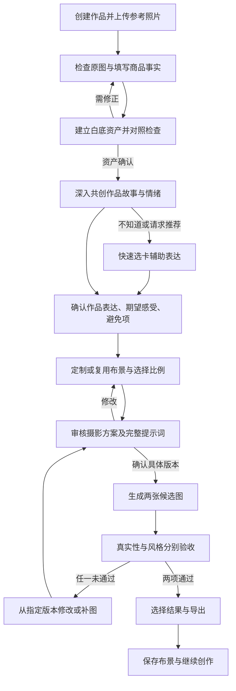

# 手作影像工作台 · 产品需求文档

| 项目 | 内容 |
| --- | --- |
| 版本 | v0.1 |
| 日期 | 2026-10-29，Asia/Shanghai |
| 文档状态 | 基于五轮共识的评审稿；尚未批准全部验收细节及待决策项 |
| 产品名称 | 「一间」为暂用名称，尚未定名 |
| 编写 | Codex，使用 prd-development 技能，依据发起人的产品描述及逐轮决策 |
| 评审 | 产品发起人；技术评审参与人待指定 |
| 首版目标 | 支持约 5 位真实手作商家的产品验证 |
| 决策依据 | [PM 审视与逐轮记录](pm-review.md)、[项目协作说明](../agents.md) |

**阅读约定：**「已确认」指用户明确接受的产品需求；「验收细化」是本稿为使需求可开发、可测试而提出的具体规则，待整体评审；🔶 **假设** 指尚无证据支持的判断；🔵 **待决策** 指尚未确定的事项。需求描述不代表当前代码已实现。

## 1. 产品摘要

面向已有可售作品、缺少摄影条件、近期希望开始线上获客的独立手作商家，建设一个理解作品故事的 AI 商品影像工作台。用户上传真实商品照片，确认白底资产，通过深入共创说明作品表达及风格，与助手共同审核摄影方案和提示词，再生成电商商品主图。工作台长期保存作品、风格、摄影布景与历史版本，支持之后的修改和复用。

首版同时追求商品真实性与画面自由度，支持静物展示；每次围绕一件作品、选择一种比例（`1:1`、`3:4`、`9:16`），生成两张候选图。结果需要真实性与风格分别通过才算完成。真人佩戴、多商品批量处理留待后续。

🔶 **假设 A1：**缺乏合适商品图是目标用户开始线上销售的重要障碍。🔶 **假设 A2：**深入共创与风格复用的价值足以覆盖操作时间。以约 5 位真实用户验证，不以原型完成或图片好看替代需求验证。

## 2. 问题、依据与证据边界

### 2.1 需要解决的问题

| 问题假设 | 对用户的可能影响 | 对应解决路径 | 需要收集的证据 |
| --- | --- | --- | --- |
| A1：缺少场地、布光和拍摄经验 | 有可售作品，但难获得适合发布的图片 | 原图检查、白底资产、定制场景 | 最近一次发布经历、现用图片、具体受阻环节 |
| A2：不会把作品故事转成视觉要求 | 无法表达想要的效果，反复修改 | 深入共创、推荐选卡、可读摄影方案 | 共创前后需求清晰程度、耗时、返工原因 |
| A3：连续作品难保持个人风格 | 每次重新试图，作品视觉不连贯 | 长期风格、布景复用、版本记录 | 第二件作品的实际复用行为与操作时间 |
| A4：生成过程可能改变商品细节 | 结果好看却无法放心用于销售 | 原图对照、保真约束、双项验收 | 用户指出的颜色、数量、结构、材质差异 |

### 2.2 已有依据

- 发起人已明确目标用户、首个使用场景及工作台价值；经过五轮讨论确认功能边界。
- 尚未提供目标用户访谈、实际发布记录、付费数据、生成效果评测或模型成本实测。
- 现有前端仅为页面骨架，没有真实 AI 能力；不构成需求或技术效果的验证证据。
- 本文没有进行外部市场研究，不声称已有市场规模、竞品优势或平台合规结论。

🔵 **待决策 O1：**目标电商平台及首批测试饰品类型。需要在试用素材和验收集确定前补齐。

## 3. 目标用户与使用任务

### 3.1 首批用户（已确认）

- 独立手作商家，有真实、可销售的饰品作品。
- 缺少摄影工作室、布光设备或相应预算，近期希望开始线上获客。
- 能提供一件近期想发布的作品，以及必要的参考照片和商品事实。
- 能参与一次试用并反馈图片是否采用；由发起人定向邀请并协调约 5 人。

纯兴趣创作用户属于更广泛的潜在人群，不作为本轮首要验证对象。具体年龄、收入、设备、经营规模和技术熟练度没有证据，不预设画像数字。

### 3.2 核心任务

> 当我准备把一件手作饰品放到线上销售时，希望有人理解作品的故事，并协助我获得真实、有自己风格的商品主图；下次上新时，还能继续使用已经建立的摄影布景和风格。

| 时点 | 用户任务 | 完成信号 |
| --- | --- | --- |
| 第一次创作 | 建档、解释作品、确定画面 | 确认商品资产、共创总结和摄影方案 |
| 生成与挑选 | 判断是否真实、是否符合风格 | 至少一张结果两项验收均通过 |
| 准备发布 | 导出可用主图 | 成功下载；实际发布单独记录 |
| 再次创作 | 修改旧作品或为新作品复用风格 | 找到原版本，或成功复用布景并确认新方案 |

## 4. 产品定位与阶段目标

### 4.1 定位（方向已确认）

为缺乏摄影条件、希望开始线上获客的独立手作商家，提供**理解手作故事的商品影像工作台**，帮助其在保留商品真实细节的同时，形成并复用自己的视觉风格。

“工作台”包括可积累的作品资产、长期风格、摄影布景、共创记录和结果版本。深入共创是新作品的默认起点。

可能的替代行为包括继续手机拍摄、简单修图、使用通用图像工具或延后发布。🔶 **假设 A5：**用户会因为故事理解、风格积累与复用而选择本产品；这些能力尚未证明优于实际替代方案或足以促成付费。

### 4.2 阶段边界

1. **交互验证：**检查流程、卡片、审核与工作台是否易于理解。模拟能力必须标明。
2. **真实能力验证：**接入实际对话、白底处理和参考图生图，验证保真、风格、比例、耗时及成本。
3. **约 5 人试用：**观察真实作品从上传到采用的全过程，复访发布及复用情况。

🔵 **待决策 O2：**付费模式、商业目标和扩大投入条件。首轮不编造收入或转化目标。实际用户试用需要真实出图，不能只用模拟预览宣称完成产品验证。

## 5. 方案总览与工作台流程

### 5.1 信息架构

| 区域 | 承载内容 |
| --- | --- |
| 作品列表 | 创建作品、继续草稿、进入已有作品 |
| 单件作品工作区 | 商品资产、信息卡、共创记录、风格卡、摄影方案、生成与版本 |
| 我的风格 | 店铺长期视觉偏好，变更需用户明确同意 |
| 摄影布景 | 可命名、保存和复用的背景、光线、道具及布局组合 |
| 历史结果 | 每张图的来源素材、方案、比例、生成任务及验收状态 |

布局与页面数量可在设计时调整，但作品、风格、布景和版本的关系必须可见。具体颜色、字体及组件尺寸不作为本 PRD 的功能约束。

### 5.2 主流程

白底资产处理与最终场景生图是不同任务。用户上传并发起白底处理后，可建立白底资产；最终场景图必须在摄影方案和提示词确认后生成。不得在共创阶段自动生成未经批准的商品场景图。

### 5.3 阶段与状态（验收细化）

- 作品主状态：草稿 → 资产待确认 → 共创中 → 总结待确认 → 方案待确认 → 可生成 → 生成中 → 待验收 → 已完成。
- 用户可回到前序环节编辑；前置条件未满足时，可以查看后续区块，但不能发起最终生图。
- 保存作品进度与批准某个方案是两种操作。保存草稿不代表允许生成。
- 每个结果独立记录真实性及风格状态：未评价／通过／未通过。任一未评价或未通过，均不标为完成。
- 修改素材、商品约束、共创总结、布景、比例或提示词，会使当前待生成方案需要重新确认；已经完成的历史结果保留当时快照，不被覆盖。

## 6. 成功指标与约 5 人验证计划

### 6.1 指标定义

以下指标口径为本稿建议，非已确认目标值。当前无历史基线，小样本优先报告「人数／实际样本数」及原因，不作统计显著性或市场规模推断。

| 类别 | 指标与口径 | 记录方式 | 基线／目标 |
| --- | --- | --- | --- |
| 主指标建议 | 实际发布采用人数：试用者在约定观察期内，至少发布一张本工具生成且双项验收通过的主图 | 由用户确认发布记录，分享链接或截图可选 | 🔵 O3：观察期及通过门槛待定；不以导出替代发布 |
| 激活 | 获得至少一张双项验收通过结果的人数／启动试用人数 | 结果验收记录 | 基线未知，试用建立 |
| 完成效率 | 首次上传到第一张合格图的总耗时；另记共创操作、服务等待与离开时长 | 事件时间与观察记录 | 🔵 O3：时间目标待定 |
| 体验 | 完成共创、转选卡、中途退出、请求人工帮助的人数及原因 | 操作事件与访谈 | 先记录基线 |
| 质量约束 | 每张候选图的真实性、风格验收；结构失真及补拍原因 | 原图对照与双项选择 | 未双通过不得计为完成，已确认 |
| 复用 | 在第二件作品上实际复用风格或布景的人数；与首次操作比较 | 后续复访或第二次任务 | 🔵 O3：复访窗口待定 |
| 成本 | 单次任务成本、失败及重试成本、每张合格图累计成本 | 服务用量，含废弃候选图 | 🔵 O4：预算和停止重试上限待定 |

### 6.2 试用安排

1. 发起人定向邀请约 5 位符合条件的商家，每人准备一件近期想发布的真实作品及照片。
2. 开始前了解最近一次准备商品图的过程、当前替代办法、预计发布渠道；不先告诉用户产品一定能提高销量。
3. 请用户完成：上传并确认资产 → 共创 → 审核方案 → 生成 → 双项验收 → 修改或导出。
4. 观察者记录卡点、人工帮助、等待、转选卡原因和未采用原因。有人辅助时单独标记，不能混算为独立完成。
5. 试用后询问是否适合实际发布、缺少哪些必要功能；在约定窗口复访真实采用与下一件作品的复用。
6. 输出每位用户的任务结果及共性问题。生成质量不足则先修复；共创价值不足则调整引导，不能自动绕过已确认的共创流程。

**单人记录模板：**匿名编号｜饰品类型｜发布渠道｜现用办法｜输入照片问题｜共创摘要｜是否转选卡及原因｜确认方案／比例｜候选图数｜两项评价及原因｜修改与补图次数｜耗时／人工帮助｜累计成本｜导出｜实际发布｜布景复用｜后续建议。

🔵 **O3：**试用前由发起人确定观察窗口、继续／调整／停止的门槛；不在看到结果后反向选择“成功标准”。

## 7. 功能需求、用户故事与验收条件

### 7.1 范围与优先级

本节均属于首版验证闭环，优先级用于安排实现依赖，不用于删减已经确认的工作台功能。

| 编号 | 能力 | 核心共识来源 |
| --- | --- | --- |
| FR-01 | 作品列表、单件工作区与进度保存 | Q10、Q13 |
| FR-02 | 多参考图、白底资产及商品对照检查 | Q11、Q14、Q18 |
| FR-03 | 商品事实与可选需求信息卡 | Q19、最初需求 |
| FR-04 | 深入共创、推荐选卡与总结确认 | Q3、Q6 |
| FR-05 | 风格卡及聊天双向编辑 | Q12、最初需求 |
| FR-06 | 长期风格与可复用摄影布景 | Q10、Q20 |
| FR-07 | 摄影方案、提示词与版本批准 | Q16、最初需求 |
| FR-08 | 三种比例、两候选图与任务反馈 | Q15、Q21 |
| FR-09 | 双项验收、指定版本修改及对比 | Q5、Q17 |
| FR-10 | 结果导出与试用记录 | 商品主图交付所需；具体格式待决策 |

下面的编号验收条件是对上述共识的细化建议；与已确认范围冲突时，以已确认需求为准，并修订本文。

### FR-01 作品工作区与保存

**用户故事：**作为商家，我希望每件作品有可继续使用的工作区，以便下次修改时找回素材、故事与方案。

- AC-01.1：创建作品后获得独立档案，作品列表显示名称、封面和当前进度；打开后恢复对应内容。
- AC-01.2：工作区提供资产、共创、方案、结果等入口，助手全程可用，不把每次回访都当成新用户。
- AC-01.3：新作品必须先完成本件作品的共创；沿用布景不能静默跳过共创。对已有且未变更的总结不重复强制访谈。
- AC-01.4：保存成功后才显示已保存；失败时说明原因并保留当前编辑内容，支持重试。
- 🔵 **O5：**正式试用的存储、身份识别、跨设备恢复与删除策略待确定。浏览器本地保存仅能证明同浏览器恢复，不能声称已实现长期云端工作台。

### FR-02 商品照片与白底资产

**用户故事：**作为商家，我希望多张真实照片共同描述商品，并能检查白底资产有没有损失细节。

- AC-02.1：一件作品可添加多张参考图，区分整体、背面或细节；修改所选素材后，后续待生成方案要求重新确认。
- AC-02.2：保留原始文件和原图，白底资产作为独立派生素材记录来源，不覆盖原图。
- AC-02.3：支持原图／白底对照与放大检查，提示检查镂空、细链、透明部分、轮廓和数量；用户明确确认才将资产标为可用。
- AC-02.4：原图模糊、商品不完整或必要角度缺失时说明具体问题并引导补拍，不能编造不可见结构。
- AC-02.5：首版支持饰品静物展示，包括平铺、悬挂、支架等；请求真人佩戴时说明本期范围，保留原需求但不伪装成可用能力。
- 🔵 **O6：**文件类型、大小、张数上限及图像处理能力需结合实际服务确定；上线前须提供一致的前后端校验和用户提示。

### FR-03 商品信息与需求卡

**用户故事：**作为商家，我希望助手了解商品事实，又不要求我先填完所有营销信息。

| 字段 | 定义及用途 | 输入规则 |
| --- | --- | --- |
| 作品名称 | 档案识别、版本归属 | 可暂用自动草稿名，允许修改；自动命名不能当成用户确认的主题 |
| 品类 | 耳饰、项链、手链等，影响摆放建议 | 核心信息；助手识别只是建议 |
| 主要材料与表面质感 | 区分金属、透明、织物等展示需求 | 核心信息；不把模型猜测写成事实 |
| 实际尺寸及单位 | 帮助选择道具与主体占比 | 核心信息，未知可标记；不能因此声称生成比例已准确 |
| 不可改变的细节 | 数量、结构、连接、纹样、颜色等 | 核心保真约束，用户可补充 |
| 售价或区间 | 理解定位 | 选填，不直接等同于某种画面风格 |
| 目标顾客／购买用途 | 帮助判断展示语境 | 选填，需要时再追问 |

- AC-03.1：核心信息允许明确记录“未知／暂不清楚”，不能自动填入虚构材料或尺寸；无法支持具体构图时再提出针对性补充要求。
- AC-03.2：更改尺寸、材料及不可改变的细节后，展示受影响的方案内容并要求重新确认。
- AC-03.3：缺少售价或目标顾客不能阻止进入共创及方案审核。

### FR-04 深入共创与快速选卡

**用户故事：**作为手作人，我希望助手先理解作品的灵感，再帮我把感觉变成画面。

- AC-04.1：新作品默认从灵感、主题、情绪等开放问题进入，根据已提供信息继续追问，不能重复问已回答的问题。
- AC-04.2：用户明确表达不知道、难以描述或请求推荐时，进入快速选卡；不依赖逐字匹配固定句子。
- AC-04.3：选卡提供可修改的方向及理由；可以选“不符合／换一组”，不强迫从不喜欢的选项中选一个。
- AC-04.4：共创结束形成三项总结：作品想表达什么、希望顾客感受到什么、明确避免什么。用户确认后才完成共创阶段。
- AC-04.5：允许记录“暂无明确故事”；助手可推荐视觉方向，但不能制造作者经历、灵感来源或材料寓意。
- AC-04.6：用户修改故事后，总结和风格建议同步更新；已批准但尚未生成的旧方案失效。

### FR-05 风格需求与双向编辑

**用户故事：**作为用户，我希望聊天和卡片描述的是同一份方案，不用重复输入。

| 风格维度 | 卡片承载信息 |
| --- | --- |
| 色调 | 背景主色、冷暖、与饰品的对比；用户可选色或用自然语言表达 |
| 背景 | 纸、布、木、石、纯色等材质与纹理强度 |
| 光线 | 方向、明暗、柔硬、冷暖、阴影；不要求用户懂摄影术语 |
| 摆放 | 平铺、悬挂、支架及商品角度；必要角度必须有素材支持 |
| 道具 | 类型、数量、位置；必须出现与禁止出现的元素 |
| 构图 | 主体占比、位置、留白和所选比例 |
| 表达 | 与共创总结对应的氛围重点，以及明确避开的效果 |

- AC-05.1：助手将用户明确表达整理进对应字段，标明本次改动；推测和推荐显示为待确认建议。
- AC-05.2：用户编辑卡片后，对话上下文与方案使用最新内容，助手不能用旧摘要覆盖手动修改。
- AC-05.3：发现冲突时指出冲突并请用户决定，例如要求无道具同时指定托盘；不能静默决定。
- AC-05.4：无需为每次草稿改动弹出审批，但最终生图必须经过完整方案确认。

### FR-06 店铺风格与摄影布景

**用户故事：**作为商家，我希望作品档案与摄影布景长期积累，让下一件作品延续自己的视觉风格。

- AC-06.1：店铺长期风格、摄影布景、单件方案分开保存，使用时显示当前来源。
- AC-06.2：用户可把满意的背景、光线、道具和布局保存为可命名布景；可保存的布景方案不等同于某张生成结果图片。
- AC-06.3：复用布景时，根据新商品及所选比例重新适配；不能带入旧商品的结构、故事、尺寸或不可改变细节。
- AC-06.4：单件调整不自动修改长期风格或已保存布景；用户明确选择更新后才写入相应对象。
- AC-06.5：布景更新不改写历史生成方案。历史结果继续对应原快照。

### FR-07 方案与提示词批准

**用户故事：**作为用户，我希望清楚知道将生成什么，并能在生成前修改。

- AC-07.1：默认显示可读方案：商品保真要求、背景、光线、摆放、道具、构图、比例及候选图数量。
- AC-07.2：完整提示词可展开并修改；更改后必须同步回可读方案，无法确定如何映射时明确显示待解决差异，不允许两份互相矛盾的内容被共同批准。
- AC-07.3：批准绑定素材版本、事实约束、共创总结、布景、比例、提示词及输出数量的具体快照。
- AC-07.4：批准之后发生相关修改，旧批准不适用于新内容；重新显示改动并确认。
- AC-07.5：未经明确确认，不发起最终场景生成；保存、继续聊天、切换页面均不构成确认。

### FR-08 生成任务与比例

**用户故事：**作为用户，我希望选择适用比例，生成两张同方案的候选主图，并知道任务进度。

- AC-08.1：每次任务选一种比例，支持 `1:1`、`3:4`、`9:16`，批准方案时显示所选比例。
- AC-08.2：同一已批准方案生成两张候选图，记录为同一任务；不能悄悄更换商品或视觉方向来凑足数量。
- AC-08.3：其他比例从所选版本继续调整构图，重新审核并生成，不用机械裁切假装完成重新构图。
- AC-08.4：显示可核实的排队、处理中、成功、部分成功或失败状态；没有进度信息时不能伪造精确百分比。
- AC-08.5：防止重复点击建立重复任务；一个候选失败时保留成功结果，显示不足两张和补齐操作，不自动无限重试。
- AC-08.6：服务未配置或仅有演示时明确标示，不把规则回复、占位图或本地构图称为 AI 生成。
- 🔵 **O7：**具体像素、允许的比例误差、模型原生尺寸限制和失败补齐方式，须技术验证后确定。若需要尺寸适配，仍须满足不裁坏商品及所批准构图的要求。

### FR-09 双项验收、修改与版本对比

**用户故事：**作为商家，我希望确定图中的商品没有变，并能从满意的版本继续修改。

- AC-09.1：每张候选图分别评价真实性和风格；真实性提供原图对照，风格提供批准方案及共创总结对照。
- AC-09.2：用户可以指出具体差异：颜色、数量、轮廓、连接结构、纹样、材质等；风格问题可定位至背景、光线、道具或构图。
- AC-09.3：两项均通过才标为完成；否则进入修改、补图或补拍，不能静默降低原风格诉求。
- AC-09.4：选定父版本后提出修改，展示变化，重新批准再生成；保留原结果，不覆盖原文件。
- AC-09.5：支持至少两版对比，能查看各自比例、方案及验收状态，不能把不同版本评价串用。
- AC-09.6：用户确认代表本次产品验收，不构成系统对商品完全保真或平台可发布的普遍保证。

### FR-10 导出与验证记录

**用户故事：**作为商家，我希望把选中的主图下载使用，并能继续找到原始创作记录。

- AC-10.1：可下载双项通过的选定结果，输出保持对应比例，不混入其他候选图；失败可重试，不能显示虚假导出成功。
- AC-10.2：未通过结果不能被标为已完成；是否允许作为草稿下载另见 O8，不能混计正式交付。
- AC-10.3：任务记录保留结果与素材、方案的关联；产品运行必须能追溯，是否另向用户提供完整档案包属于后续决定。
- AC-10.4：导出事件与实际发布反馈分开记录。试用数据用匿名标识，不在一般事件中存储整段聊天或商品原图。
- 🔵 **O8：**PNG／JPEG、像素与压缩质量、是否提供草稿下载及是否带标记待定；不得默认强制水印。

### 7.2 数据对象与版本关系（验收细化）

| 对象 | 必要关联与状态 |
| --- | --- |
| 作品 | 名称、商品事实、资产列表、当前进度、会话、方案与版本 |
| 商品资产 | 原图／细节图／白底图、来源、处理任务、确认状态 |
| 共创总结 | 表达、期望感受、避免项、来源及确认版本 |
| 长期风格 | 店铺偏好及用户明确同意的变更记录 |
| 摄影布景 | 名称、背景、光线、道具、布局、版本 |
| 摄影方案 | 素材及事实快照、总结版本、布景参数、比例、提示词、输出数量、批准状态 |
| 生成任务 | 已批准方案版本、执行状态、服务记录、失败及重试、候选图 |
| 结果版本 | 对应任务、父结果、图片、两项验收、修改原因、导出记录 |

对象标识与物理数据库结构由技术设计确定。关键约束是历史可追溯、当前草稿可编辑、长期偏好不被单件修改污染。

### 7.3 关键异常与非功能要求（验收细化）

| 场景 | 必须满足的行为 |
| --- | --- |
| 页面刷新或中断 | 恢复已保存内容；生成中的任务按实际服务状态处理，不能默认重新提交 |
| 图片／服务失败 | 保留已上传及成功结果，指出失败对象，提供恢复路径 |
| 所选素材被删除或替换 | 不再允许用失效引用发起新任务；历史关联及删除保留策略在 O5 确定 |
| 审核后比例或提示词变化 | 失效旧批准，重新展示变化并确认 |
| 故事或风格修改 | 更新受影响内容，不自动改写所有历史结果或店铺风格 |
| 浏览器存储满或服务不可达 | 显示未保存状态，不能误报草稿已保存 |
| 触屏与键盘使用 | 上传、表单、对话、批准、对比及导出可完成；主要操作有可访问名称与反馈 |
| 数据与密钥 | 密钥不进入前端或版本库；上传、聊天和卡片按不可信输入处理 |

🔵 **O9：**支持的设备／浏览器、性能目标、任务超时与保留时长待技术评审。真实用户数据对外传输、访问隔离、删除和保留方式必须在试用前明确说明并落实。

## 8. 本期范围之外

| 已确认后续事项 | 理由 |
| --- | --- |
| 真人佩戴与人体场景 | 本期先验证静物商品主图，需单独评估接触、比例及真实细节 |
| 多商品批量处理 | 本期共创和验收围绕单件作品，多参考图仍支持 |
| 首次任务同时生成三种比例 | 已确认一次选择一种比例，其他比例重新构图及批准 |
| 带字营销主图、完整详情页制作 | 首条交付为无字单品主图；完整详情页尚未纳入 |

本稿不承诺店铺自动发布、交易管理、付款订阅、完整品牌设计工具或平台全适配。🔵 **O10：**上述未讨论能力若被纳入，应单独评估，不能反向挤占已确认工作台功能。

## 9. 依赖、风险与交付顺序

### 9.1 依赖与控制

以下负责人按角色建议分配，实际人选待指定。

| 风险／依赖 | 类别 | 触发信号 | 处理及责任角色 |
| --- | --- | --- | --- |
| 用户并非因图片而迟迟不上线 | 价值，A1 | 访谈与试用显示主要障碍在其他环节 | 产品发起人核对原始任务，调整价值判断，不能直接归因于图片 |
| 深入共创负担大于收益 | 易用性，A2 | 退出、重复解释、频繁转选卡 | 产品记录原因，优化追问与卡片；保持用户已确认的默认共创入口 |
| 透明、反光、细链等素材处理不可靠 | 可行性，A4 | 白底或结果检查多次出现结构差异 | 技术与产品建立真实素材评测集；失败进入修正或补拍 |
| 自由摆放要求依赖未拍摄角度 | 可行性 | 无法从参考图确认隐藏结构 | 要求补充素材，不把推断写成事实，不把提示词等同于保真能力 |
| 结果漂亮但无实际采用 | 价值，A5 | 导出后不发布、无复用 | 复访具体原因，检查风格理解与交付范围 |
| 重试导致单位合格图成本过高 | 可持续性 | 大量重试及合格结果少 | 记录含失败的累计成本，试用前确定预算与暂停条件 O4 |
| 长期工作台仅存在单设备缓存 | 可行性／信任 | 换设备丢记录，存储被清除 | 技术先明确 O5；本地演示标明边界，试用前落实恢复方案 |
| 平台规格与目标输出不符 | 外部依赖 | 被目标渠道拒收或必须重新处理 | 确定 O1 后核验官方规范，再决定适配，不宣称三种比例全平台通用 |
| 服务商及图片处理链尚未选定 | 交付依赖 | 无法实际白底处理、对话或生图 | 技术完成小样本能力评测与接口设计，配置在服务端管理 |

### 9.2 建议交付顺序

不承诺未经评估的工期；以下为依赖顺序。

| 阶段 | 交付 | 进入下一阶段条件 |
| --- | --- | --- |
| M0 文档评审 | 本 PRD、关键未决项、素材评测计划 | 核心范围一致，试用阻塞项有负责人 |
| M1 可交互工作台 | 单件资产、共创、选卡、双向编辑、审核、比例、版本、布景 | 主链可操作；演示与真实能力明确区分 |
| M2 真实能力接入 | 白底、对话、参考图生成、两候选、双验收、真实导出及存储 | 用真实素材验证能力和失败处理；O4—O9 关键项解决 |
| M3 约 5 人试用 | 任务记录、发布反馈、复用反馈、质量与成本记录 | 按事先确定门槛讨论继续、调整或停止 |

🔵 **O11：**技术负责人、实现资源及时间安排尚未确定。已有 HTML／CSS 骨架不代表 M1 已完成；`app.js` 尚缺，实际服务均未接入。

## 10. 待决策事项与评审入口

| 编号 | 问题 | 建议负责角色 | 必须解决的节点 |
| --- | --- | --- | --- |
| O1 | 首批目标平台、饰品类型与真实素材集 | 发起人＋产品 | 确定试用任务及平台适配前 |
| O2 | 付费、商业目标、扩大投入条件 | 发起人 | 商业试验前；不阻塞基础流程设计 |
| O3 | 主指标采用、观察期、样本记录与继续／调整／停止门槛 | 发起人＋产品 | 首次正式试用前 |
| O4 | 单用户／整体预算、重试及成本暂停条件 | 发起人＋技术 | 真实服务调用及试用前 |
| O5 | 本地／云端保存、身份、跨设备、删除与恢复 | 产品＋技术 | 存储实现及真实试用前 |
| O6 | 图片类型、大小、张数、补拍及处理能力 | 产品＋技术 | 上传与处理验收前 |
| O7 | 输出像素、比例适配、模型服务及部分失败补齐 | 产品＋技术 | 真实生成验收前 |
| O8 | 导出格式、质量与草稿下载规则 | 产品＋技术 | 导出验收前 |
| O9 | 设备、性能、超时、保留时长及数据传输边界 | 产品＋技术 | 试用前 |
| O10 | 未讨论扩展功能是否纳入 | 发起人＋产品 | 如需扩大本期范围时 |
| O11 | 负责人、开发资源、排期与阶段验收安排 | 发起人＋技术 | 开发计划承诺前 |

以上为节点要求，不是已承诺日期或已接受的角色任命。未决项不阻止开始讨论设计，但涉及真实数据、费用及外部服务的阻塞项不能默认已解决。

## 附录 A：五轮决策追溯

| 共识 | 来源及覆盖关系 |
| --- | --- |
| 目标为约 5 人真实试用，由发起人定向邀请协调 | Q4、Q7 |
| 首批为已有可售作品且有近期线上获客需求的独立商家 | 第一轮 Q1 在第二轮补齐 |
| 真实性与自由度同时追求，双项通过才算完成 | 第一轮修改 Q2，第二轮 Q5 确认验收原则 |
| 深入共创优先，不知道时转选卡，确认三项总结 | Q3、Q6；覆盖先前快速入口优先建议 |
| 故事理解与个人视觉风格为核心定位 | Q8 |
| 首个主场景为电商商品主图 | Q9 用户调整，覆盖社交作品图组优先建议 |
| 强调长期工作台、店铺风格及单件档案 | Q10、Q13 |
| 单件作品、多参考图，聊天与卡片双向同步 | Q11、Q12 |
| 白底资产需要检查，保留原图与细节 | Q14 |
| 无字、单件，三种可选比例 | Q15 用户修正为 1:1、3:4、9:16 |
| 可读方案与完整提示词审核，确认后生成 | Q16、最初需求 |
| 指定版本修改、历史保留与对比 | Q17 |
| 静物优先，真人佩戴后续 | Q18 |
| 核心商品事实允许未知，售价及顾客选填 | Q19 |
| 保存并复用可命名摄影布景 | Q20 |
| 每次一种比例，两张候选，其他比例重新构图 | Q21 |

## 附录 B：文档自评

- **最完整部分：**工作台流程、用户确认规则、功能边界及版本关联；均可追溯到逐轮决策。
- **最弱部分：**用户问题证据、具体服务能力、单位合格图成本及发布采用基线；不能靠补写文档证明。
- **高风险假设：**A1 图片是重要障碍；A2 深入共创值得花时间；A4 在可接受成本内同时实现保真与自由度；A5 用户会实际采用并复用。
- **建议下一步：**先组织真实饰品素材与能力评测，补齐 O1、O4、O7 的关键输入，同时以本文评审工作台主链；试用前锁定 O3，避免事后改变成功定义。

## 变更记录

| 版本 | 日期 | 内容 |
| --- | --- | --- |
| v0.1 | 2026-10-29 | 基于五轮 grilling 共识创建；将验收细化、假设和未决项单独标明，未声称代码已实现 |
