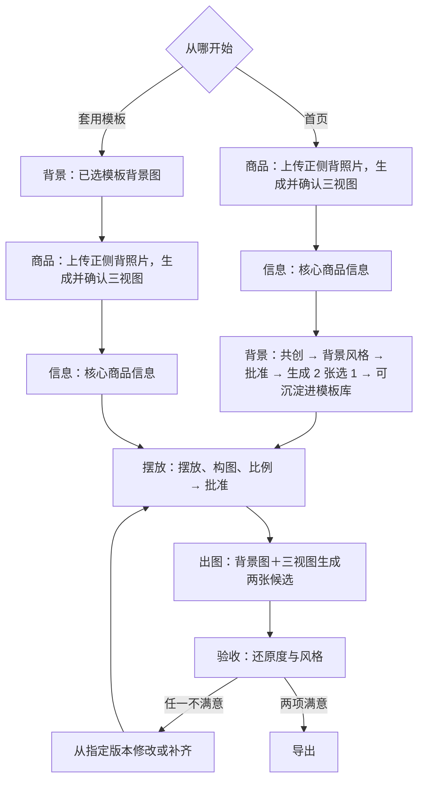

# 手作影像工作台 · 产品需求文档

| 项目 | 内容 |
| --- | --- |
| 版本 | v0.6 |
| 日期 | 2026-11-22，Asia/Shanghai（v0.1 起于 2026-10-29） |
| 文档状态 | 评审稿。v0.6 把出图改为「三视图 → 背景图 → 合成」，分「首页开始」「套用模板」两套 5 步流程，模板库取代「我的风格」和「摄影布景」；需求发起人已确认，代码仍是 v0.5，实现写法见 [技术写法](tech-design.md) 第 13 节（待确认） |
| 产品名称 | 「一间」为暂用名称 |
| 编写 | v0.1 由 Codex 编写；v0.2—v0.6 由 Claude Code 按发起人意见修订 |
| 评审 | 产品发起人；技术评审人待指定 |
| 首版目标 | 支持约 5 位真实手作商家试用 |
| 决策依据 | [项目协作说明](../agents.md)（「需求共识」等节；逐轮问答原文已删，见提交 `1392038` 的 `docs/pm-review.md`） |

**阅读约定：**「已确认」指用户明确接受的需求；「验收细化」是本稿为可开发、可测试而提出的规则，待评审；🔶 **假设** 指尚无证据的判断；🔵 **待决策** 指未定事项，⛔ 标记表示**进入开发前必须定**。本文是目标需求，不代表代码已实现。

## 1. 产品摘要

面向已有可售作品、缺少摄影条件、近期希望开始线上获客的独立手作商家，做一个理解作品故事的 AI 商品影像工作台。**AI 助手「小间」（Agent）是产品核心**：用户上传真实商品照片、用自己的话说想要什么，小间在对话中带着用户确认商品资产、共创背景、审核方案和提示词，生成电商商品主图，并跟进验收和修改。流程步骤只作为次要的进度可视化。

出图分三段：用户上传正面、侧面、背面照片后生成商品**三视图**（白底）；再生成一张不含商品的**背景图**；最后以背景图和三视图为参考，把饰品生成进背景。满意的背景图可以沉淀进**模板库**，下一件作品直接套用，延续同一个取景或工作室的感觉。

首版支持饰品静物展示。每次围绕一件作品、从多个可选比例中选一种，生成两张候选图。真实性和风格分别由用户验收，两项都满意才算完成。小间可以调用全部产品能力，但批准生成、沉淀或删除背景图、花钱上限等硬规则由代码保证（见 4.2）。真人佩戴、多商品批量处理留待后续。

🔶 **假设 A1：**缺乏合适商品图是目标用户开始线上销售的重要障碍。🔶 **假设 A2：**背景共创与背景复用的价值足以覆盖操作时间。两者都靠约 5 位真实用户试用验证。

## 2. 问题与证据

### 2.1 需要解决的问题

| 问题假设 | 对用户的影响 | 解决路径 | 需要收集的证据 |
| --- | --- | --- | --- |
| A1：缺少场地、布光和拍摄经验 | 有可售作品，但没有适合发布的图片 | 原图检查、三视图、定制背景 | 最近一次发布经历、现用图片、具体卡在哪一步 |
| A2：不会把作品故事转成视觉要求 | 说不清想要的效果，反复修改 | 背景共创、推荐选卡、可读方案 | 共创前后需求清晰程度、耗时、返工原因 |
| A3：连续作品难保持个人风格 | 每次从头试，作品视觉不连贯 | 背景图沉淀进模板库并复用、版本记录 | 第二件作品的实际套用行为与操作时间 |
| A4：生成过程可能改变商品细节 | 图好看但不敢用于销售 | 正侧背实拍、三视图逐张确认、用户验收 | 用户指出的颜色、数量、结构、材质差异及满意度 |

### 2.2 现有依据

- 发起人已明确目标用户、首个使用场景和工作台价值，五轮讨论确认了功能边界。
- 还没有用户访谈、发布记录、付费数据、生成效果评测或成本实测。`原型-v3/` 是本地交互原型，未接任何模型；`正式代码/` 已接入真实对话与生图，实现的是 v0.5 的一步出图，还没在真实饰品上系统测过效果和成本。v0.6 的三视图和两步出图没有任何实测。
- 本文未做外部市场研究。

## 3. 目标用户与使用任务

### 3.1 首批用户（已确认）

- 独立手作商家，有真实可售的饰品作品。
- 缺少摄影工作室、布光设备或相应预算，近期希望开始线上获客。
- 能带一件近期想发布的作品、正面侧面背面照片和商品信息，参与一次试用并反馈是否采用。由发起人定向邀请约 5 人。

纯兴趣创作者属于更广的潜在人群，本轮不作为首要验证对象。年龄、收入、设备等画像没有证据，不预设。

### 3.2 核心任务

> 当我准备把一件手作饰品放到线上销售时，希望有人理解作品的故事，帮我得到真实、有自己风格的商品主图；下次上新时，还能继续用已经建立的背景。

| 时点 | 用户任务 | 完成信号 |
| --- | --- | --- |
| 第一次创作 | 建档、确认三视图、共创背景 | 三视图确认、背景选定 |
| 生成与挑选 | 判断是否还原、是否符合风格 | 至少一张结果两项都满意 |
| 准备发布 | 导出主图 | 下载成功；实际发布另行记录 |
| 再次创作 | 改旧作品，或套用模板库里的背景做新作品 | 找到原版本，或套用背景并确认新方案 |

## 4. 产品定位与阶段目标

### 4.1 定位（已确认）

为缺乏摄影条件、希望开始线上获客的独立手作商家，提供**理解手作故事、沉淀自己背景风格的商品影像工作台**，帮助他们在尽量还原商品细节的同时，形成并复用自己的视觉风格（2026-11-22 发起人确认改写：首页开始的作品通过共创理解故事，套用模板的作品延续已沉淀的背景）。

“工作台”包括可积累的作品资产（原图与三视图）、模板库（背景图）、共创记录和结果版本。首页开始的新作品以背景共创为默认起点；套用模板的作品不做共创。用户主要通过和小间对话完成工作，工作台负责把对话的结果变成看得见、可直接修改的内容。

用户的替代做法包括继续手机拍摄、简单修图、用通用图像工具或延后发布。🔶 **假设 A5：**用户会因为故事理解和风格复用选择本产品。

### 4.2 首版 AI 能力边界（已确认）

| 能力 | 首版 | 说明 |
| --- | --- | --- |
| 生成饰品场景图 | 必须有，真实接入 | 三视图 → 背景图 → 合成（v0.6）；试用必须真实出图 |
| 商品三视图 | 必须有 | 用正面、侧面、背面照片各生成一张白底图，合成只用三视图（v0.6，取代 v0.5 的白底资产与 A/B 测试） |
| 可调用全部产品能力的 AI 助手（Agent） | **必须有**（v0.3） | 小间理解用户的自由表达，主导整个流程，调用产品能力完成工作；见 FR-11 |
| 共创对话 | 由小间用大模型进行（v0.3） | 卡片保留，作为对话结果的可编辑载体和「我不知道」时的快速选择 |

**Agent 硬规则（2026-10-31 发起人确认，v0.6 修订，代码保证）：**模型负责理解、追问、整理、起草和推荐；下面这些决定写成代码或配置，模型无法修改或绕过：

1. 背景图和合成的生成与补齐，只在存在有效批准时执行；批准只能由用户在界面上明确操作产生，小间不能代为批准（Q16、AC-07.5）。三视图由用户点按钮生成，小间只能提议。
2. 背景图沉淀进模板库、改名、删除，需要用户在界面上明确操作；小间不能代为沉淀或删除（AC-06.4）。
3. 推测和推荐只能写成「待确认建议」，不能写成已确认的商品信息或共创总结；不编造作者经历、灵感、材料或尺寸（AC-03.1、AC-04.5、AC-05.1）。
4. 每次生成、重试和对话都计入成本；单次任务、重试次数和总预算的上限写在配置里，达到上限就暂停并告诉用户（O4）。
5. 删除作品或素材、替换原图需用户确认；原图始终保留（AC-02.2）。

### 4.3 三视图（2026-11-22 发起人确认）

- 用户必须上传正面、侧面、背面三张照片；缺任何一张，「生成三视图」不能点。可以另传细节照。
- 用户点按钮生成三张独立的白底三视图（正、侧、背各一张），逐张对照对应角度的原图确认；不像的可以单独重做那一张（每个角度有次数上限；发起人判断不会出现重做到上限仍不满意的情况，不另做处理）。三张都确认，商品资产才完成。三视图是必做的一步。
- 合成时参考图固定为 1 张背景图＋3 张三视图（候选模型最多收 4 张参考图）；原图和细节照不进合成。
- v0.5 的白底资产步骤与「白底 vs 原图直出」A/B 测试取消，试用操作员的路线开关一并去掉；抠图服务的调研（阿里云「商品分割」）不再需要。

### 4.4 阶段目标

1. **产品与能力验证：**做出完整产品并接入真实对话模型和生图模型，在产品里用真实饰品走完两套流程，验证三视图还原度、两步出图能否看出同一取景、氛围、比例、耗时和成本。
2. **工作台验证：**检查小间的对话引导、卡片、审核与工作台是否易懂，选定生图模型和对话模型。
3. **约 5 人试用：**观察真实作品从上传到采用的全过程，复访发布和复用情况。

🔵 **待决策 O2：**付费模式、商业目标和扩大投入条件。不阻塞开发。

## 5. 方案总览与工作台流程

### 5.1 信息架构

| 区域 | 承载内容 |
| --- | --- |
| 首页 | 以对话输入框为中心：上传作品照片、用一句话说明需求即开始（流程一）；下方是模板库的背景图（内置＋自己沉淀的），点「套用」直接开始（流程二） |
| 作品列表 | 单独的作品页（网格）：创建作品、继续草稿、进入已有作品；侧栏为图标导航 |
| 单件作品工作区 | **对话为主**：和小间的对话是主区域，小间把信息、共创总结、方案、候选图做成卡片放进对话；**画布**展示当前步骤的内容，可直接修改；流程步骤缩为顶栏进度，可点开任一已到达的步骤查看和修改 |
| 模板库 | 内置模板背景图和自己沉淀的背景图；每张显示方案参数（色调、背景、光线、道具）、来源、被几件作品用过，可「套用」、改名、删除。取代 v0.5 的「我的风格」「摄影布景」两页 |
| 历史结果 | 每张图的来源素材、背景图、方案、比例、生成任务及验收状态 |

布局和页面数量可在设计时调整，但作品、背景图和版本之间的关系必须看得见。对话为主的布局参考 `原型-v3/`（2026-10-30 发起人确认：左对话、右画布、顶栏细进度，首页输入框居中，侧栏为图标栏）。

### 5.2 两套流程（2026-11-22 发起人确认）

两套流程都是 5 步，只是顺序不同；进度条按各自的顺序显示。

| 流程 | 入口 | 步骤 |
| --- | --- | --- |
| 流程一 | 首页上传照片或说一句话 | ① 商品 → ② 信息 → ③ 背景 → ④ 摆放 → ⑤ 出图 |
| 流程二 | 点模板库里背景图的「套用」 | ① 背景（进来即完成）→ ② 商品 → ③ 信息 → ④ 摆放 → ⑤ 出图 |

| 步骤 | 内容 | 用户确认 |
| --- | --- | --- |
| 商品 | 上传正面、侧面、背面照片，可另传细节照；点按钮生成三视图；逐张对照原图确认，不像就单独重做 | 三张三视图都确认 |
| 信息 | 品类、材料、尺寸、不可改变的细节；售价、目标顾客选填 | 处理小间的信息建议 |
| 背景（流程一） | **背景共创**（作品故事、氛围）→ 三项总结 → 背景风格（色调、背景、光线、装饰道具）→ 小间写背景提示词 → 批准 → 生成 2 张背景图 → 选 1 张 → 可选「沉淀进模板库」 | 确认总结；**第 1 次批准**；选定背景 |
| 背景（流程二） | 显示套用的背景图和它的参数（只读）；可换一张模板；选「自己设计背景」切换到流程一，已传的商品和信息保留 | — |
| 摆放 | 摆放（平铺、悬挂、支架等展示用具）、构图、比例（只有这里可选）→ 小间写合成提示词 | **批准**（流程一第 2 次，流程二唯一一次） |
| 出图 | 背景图＋三视图生成 2 张候选 → 验收还原度（对照原图）和风格 → 修改、补齐或导出 | 两项验收 |

由小间在对话中推进；用户也可以直接在画布里编辑任一已到达的环节。三视图、背景图、合成是三种生成任务：三视图由用户点按钮生成，背景图和合成都在对应的方案和提示词批准后才生成。流程二不做共创、不生成背景。

### 5.3 阶段与状态（验收细化）

- 流程一：草稿 → 资产待确认 → 信息待处理 → 共创中 → 总结待确认 → 背景待批准 → 背景生成中 → 背景待选定 → 方案待确认 → 可生成 → 生成中 → 待验收 → 已完成。流程二没有共创和背景的状态。
- 用户可回到前序环节编辑；前置条件未满足时可以查看后续区块，但不能发起生成。
- 保存草稿和批准方案是两种操作，保存不等于允许生成。
- 每个结果分别记录还原度和风格：未评价／满意／不满意。任一项不是“满意”就不标完成。
- 修改三视图、商品信息、共创总结、背景图、比例或提示词后，待生成方案需重新确认；已完成的历史结果保留当时快照。

## 6. 成功指标与约 5 人试用计划

### 6.1 指标定义

口径为本稿建议，目标值待定。样本小，报告时用「人数／实际样本数」加原因，不做统计推断。

| 类别 | 指标与口径 | 记录方式 | 目标 |
| --- | --- | --- | --- |
| 主指标（O3 已定） | 采用意愿人数：试用结束时明确表示会把本工具生成、两项都满意的主图用于发布 | 试用结束当场询问并记录原话 | ≥3 人继续；1–2 人调整；0 人停止 |
| 参考 | 事后实际发布人数（用户主动告知即记录，不设观察期） | 用户自愿反馈 | 不计入门槛 |
| 激活 | 获得至少一张两项都满意的结果的人数／启动试用人数 | 验收记录 | 试用建立基线 |
| 满意度 | 对候选图还原度和风格的满意情况及原因 | 验收选择＋访谈 | 试用建立基线 |
| 完成效率 | 首次上传到第一张满意图的总耗时；另记共创操作、等待和离开时长 | 事件时间与观察记录 | 试用建立基线 |
| 体验 | 完成共创、转选卡、中途退出、请求帮助的人数及原因；小间理解错、需要用户纠正的次数；三视图重做次数 | 操作事件、对话记录与访谈 | 试用建立基线 |
| 复用 | 第二件作品实际套用模板库背景图的人数 | 用户再次使用时记录（同一设备，见 O5） | 试用建立基线 |
| 成本 | 单次任务成本、失败重试成本、每张满意图累计成本；对话（大模型）费用单列 | 服务用量，含废弃的三视图、背景图、候选图和对话调用 | 生图与对话合计 500 元内，生图优先（O4） |

### 6.2 试用安排

1. 发起人定向邀请约 5 位商家，每人准备一件近期想发布的真实作品，并拍好正面、侧面、背面照片。**远程试用**（2026-10-31 已确认）：商家在大陆用自己的电脑浏览器打开网址，发起人通过视频通话等方式远程陪同；服务端部署在香港（不需要 ICP 备案，可调用所选网关）。
2. 开始前了解最近一次准备商品图的过程、现用办法和预计发布渠道。不预先承诺能提高销量。
3. 用户完成：上传并确认三视图 → 信息 → 背景（共创或套用模板）→ 摆放 → 生成 → 验收 → 修改或导出。
4. 观察者（远程）记录卡点、人工帮助、等待、转选卡和未采用的原因；有人辅助的单独标记。
5. 试用结束当场询问：会不会用这张图发布、为什么、缺什么功能。不设观察期；用户事后主动告知发布或再次使用时补记。
6. 输出每位用户的结果和共性问题。生成质量不足先修生成；共创价值不足调整引导。

**单人记录模板：**匿名编号｜饰品类型｜发布渠道｜现用办法｜照片问题｜流程一或二｜共创摘要｜是否转选卡及原因｜三视图重做次数｜背景图张数｜摆放／比例｜候选图数｜还原度与风格评价及原因｜修改与补图次数｜耗时／人工帮助｜累计成本｜导出｜实际发布｜背景是否沉淀／复用｜建议。

## 7. 功能需求与验收条件

### 7.1 范围

以下均属首版。编号验收条件是对共识的细化建议，与已确认需求冲突时以已确认为准。

| 编号 | 能力 | 共识来源 |
| --- | --- | --- |
| FR-01 | 作品列表、单件工作区与进度保存 | Q10、Q13 |
| FR-02 | 正侧背照片、三视图与对照检查 | Q11、Q14、Q18、v0.6 |
| FR-03 | 商品信息与可选需求卡 | Q19、最初需求 |
| FR-04 | 背景共创、推荐选卡与总结确认 | Q3、Q6、v0.6 |
| FR-05 | 风格卡及聊天双向编辑 | Q12、最初需求 |
| FR-06 | 背景图与模板库 | Q10、Q20、v0.6 |
| FR-07 | 方案、提示词与版本批准 | Q16、最初需求 |
| FR-08 | 两步生成、多比例可选、两张候选与任务反馈 | Q15、Q21、v0.6 |
| FR-09 | 用户验收、指定版本修改及对比 | Q5、Q17 |
| FR-10 | 结果导出与试用记录 | 主图交付所需 |
| FR-11 | 小间（Agent）：对话主导与工具调用 | v0.3 发起人决定 |

### FR-01 作品工作区与保存

**用户故事：**作为商家，我希望每件作品有可继续使用的工作区，下次修改时能找回素材、背景与方案。

- AC-01.1：创建作品后获得独立档案，列表显示名称、封面和当前进度；打开后恢复对应内容。
- AC-01.2：工作区以对话为主，顶栏进度按这件作品的流程（5.2）显示 5 个环节的入口；回访时小间接着上次的进度继续，不把用户当成新用户。
- AC-01.3：流程一的新作品必须在背景步骤完成背景共创；已有且未变更的总结不重复访谈。流程二套用模板，不做共创（2026-11-22 发起人决定）。
- AC-01.4：保存成功才显示“已保存”；失败时说明原因、保留编辑内容并可重试。
- **O5（已定）：**试用期数据存在浏览器本地，不做账号和跨设备同步。复访须用同一设备和浏览器，试用前告知用户；清除浏览器数据会丢失记录。

### FR-02 商品照片与三视图

**用户故事：**作为商家，我希望用真实照片描述商品，并检查生成的三视图有没有丢细节。

- AC-02.1：照片分正面、侧面、背面、细节四类；正面、侧面、背面三张必须都有，否则「生成三视图」不能点，并写明缺哪一张。改动照片后，受影响的三视图和待生成方案需重新确认。
- AC-02.2：原图始终保留；三视图作为派生素材存进这件作品的资产，记录来源原图，不覆盖原图。
- AC-02.3：三视图由用户点按钮生成（小间只能提议），正、侧、背各一张独立的白底图；每张与同角度原图并排放大对照，提示看镂空、细链、透明部分、轮廓和数量；不像的可单独重做（次数有上限）；三张都确认，资产才完成。
- AC-02.3a：合成的参考图固定为 1 张背景图＋3 张已确认的三视图；原图和细节照不进合成，细节照用于小间理解商品和填写「不可改变的细节」。
- AC-02.4：原图模糊、商品不完整时说明问题并引导补拍，不编造看不到的结构。
- AC-02.5：首版支持饰品静物展示（平铺、悬挂、支架等）；用户要求真人佩戴时说明本期不支持，保留需求。
- AC-02.6：v0.6 取消（原为记录白底 A/B 路线，A/B 对比已取消）。
- 🔵 **O6：**文件类型、大小、张数上限，结合实际服务确定，前后端校验一致。

### FR-03 商品信息与需求卡

**用户故事：**作为商家，我希望小间从照片和我说的话里了解商品信息，又不要求我先填完所有营销信息。

| 字段 | 用途 | 输入规则 |
| --- | --- | --- |
| 作品名称 | 档案识别、版本归属 | 可先用自动草稿名，允许修改 |
| 品类 | 耳饰、项链、手链等，影响摆放建议和背景留位 | 核心信息；系统识别只作建议 |
| 主要材料与表面质感 | 区分金属、透明、织物等展示需求 | 核心信息；不把模型猜测写成事实 |
| 实际尺寸及单位 | 帮助选择道具与主体占比 | 核心信息，可标“未知” |
| 不可改变的细节 | 数量、结构、连接、纹样、颜色等 | 核心保真约束，用户可补充 |
| 售价或区间 | 理解定位 | 选填 |
| 目标顾客／购买用途 | 判断展示语境 | 选填，需要时再问 |

- AC-03.1：核心信息可记为“未知”，不自动填入虚构的材料或尺寸；影响构图时再针对性追问。
- AC-03.2：改动尺寸、材料或不可改变的细节后，展示受影响的方案内容并要求重新确认。
- AC-03.3：没填售价或目标顾客，不影响进入后续步骤。
- AC-03.4（2026-11-06 发起人选定）：核心信息还有小间的建议没接受或忽略时，批准处提醒「还有几条信息建议没处理、没接受的不会用于生成」，可跳到信息页；不挡批准。

### FR-04 背景共创与快速选卡

**用户故事：**作为手作人，我希望小间先理解作品的灵感，再帮我把感觉变成背景。

共创只在流程一的背景步骤进行，总结是背景提示词的依据，也作为合成提示词的氛围依据；流程二不做共创。

- AC-04.1：小间在对话中提出灵感、主题、情绪等开放问题，根据用户的回答追问；已经说过或填过的内容不重复问。
- AC-04.2：用户说「不知道」「你帮我推荐」等意思时，小间识别并进入快速选卡；同时保留一个明确的「我不知道，给我推荐」按钮，不依赖识别。
- AC-04.3：选卡给出可修改的方向和理由，可选“都不合适／换一组”。
- AC-04.4：共创结束形成三项总结：作品想表达什么、希望顾客感受到什么、明确避免什么。用户确认后共创才完成。
- AC-04.5：允许记录“暂无明确故事”；助手可推荐视觉方向，但不编造作者经历、灵感或材料寓意。
- AC-04.6：用户修改故事后，总结和背景风格建议同步更新；已批准未生成的方案失效；已选定的背景图不强制作废，提示用户是否重新生成。

### FR-05 风格需求与双向编辑

**用户故事：**作为用户，我希望聊天和卡片描述的是同一份方案，不用重复输入。

| 风格维度 | 归属 | 卡片内容 |
| --- | --- | --- |
| 色调 | 背景 | 背景主色、冷暖、与饰品的对比；可选色或用自然语言描述 |
| 背景 | 背景 | 纸、布、木、石、纯色等材质与纹理强度 |
| 光线 | 背景 | 方向、明暗、柔硬、冷暖、阴影；不要求懂摄影术语 |
| 道具 | 背景 | 装饰道具（苔藓、旧书、丝带等）的类型、数量、位置；必须出现与禁止出现的元素 |
| 摆放 | 摆放 | 平铺、悬挂、支架及商品角度；**展示用具**（支架、挂钩、首饰托盘等）归这里，合成时加进画面 |
| 构图 | 摆放 | 主体占比、位置、留白和所选比例 |

展示用具和装饰道具的分法 2026-11-22 发起人确认：套用的背景里没有支架时，合成时按摆放加上，不需要改背景。归属为「背景」的四项写进背景提示词；背景图选定后以背景图记录的参数为准、只读，想改就生成新背景。归属为「摆放」的两项每件作品自己定。v0.5 的「表达」项删除，由共创总结直接作为提示词依据。

- AC-05.1：助手把用户明确说过的内容整理进对应字段并标明改动；推测和推荐显示为待确认建议。
- AC-05.1a（2026-11-06 发起人选定）：风格卡标「你说的」时，小间必须附上用户原话片段，代码在用户的消息和用户手改提示词新写的内容里逐字核对，找不到就记为「小间推荐」；卡片上显示这段原话。代码只核对片段在不在，不判断片段和这一项是否相关。
- AC-05.2：用户手动编辑卡片后，对话和方案使用最新内容，不被旧摘要覆盖。
- AC-05.3：发现冲突（如要求无道具又指定托盘）时指出并请用户决定。
- AC-05.4：草稿改动不需要逐次审批，但生成必须经过完整方案确认。

### FR-06 背景图与模板库

**用户故事：**作为商家，我希望满意的背景能留下来，下一件作品直接放进同一个取景，让店里的图看起来是一套。

发起人决定（2026-11-22）：

- 先生成**不含商品的背景图**，再以背景图和三视图为参考，把饰品生成进背景；不在流程里一步生成成品图。
- 背景图可复用，**模板库取代「我的风格」和「摄影布景」**；背景图上显示它的方案参数。
- 「套用」用的是**原来那张背景图**，结合这件饰品的摆放生成。
- 复用**不要求背景一模一样**：合成时模型可以重画整张图、有一些变化，只要看得出是同一个取景或同一个工作室。
- 比例不受限：每次合成都按所选比例重新生成，背景图的比例和这次不同也可以套用。
- 背景一次生成 2 张，用户选 1 张；选定的那张由用户选择是否「沉淀进模板库」，不选就不进。
- 内置模板背景图由发起人准备，替换现在的 4 个色块模版；内置模板的方案参数先留空（发起人 2026-11-22 定）。
- 旧的「我的风格」「摄影布景」数据不迁移，升级时删除；旧作品也一并删除（都是开发测试数据，发起人 2026-11-22 定）。

验收条件：

- AC-06.1：模板库收内置模板背景图和用户沉淀的背景图；每张显示缩略图、方案参数（内置模板暂无参数，不显示）、来源（内置／出自哪件作品）、沉淀时间和被几件作品用过；作品里显示当前用的是哪张背景图。
- AC-06.2：背景图是**不含商品**的图；背景提示词要求画面里没有任何饰品和文字。代码判断不了图里有没有商品，选定和沉淀时界面提示「图里不能有饰品」，由用户把关。
- AC-06.3：套用背景图时只带入背景图和它的方案参数，不带入原作品的商品、故事、尺寸或细节约束；摆放、构图由这件作品重新决定。
- AC-06.4：沉淀、改名、删除背景图需要用户在界面上操作；删除不影响已经用过它的作品和结果（历史结果仍能看到当时的背景图）。小间可以推荐背景图，不能沉淀或删除。
- AC-06.5：背景图生成后不再修改；想调整就生成一张新的，旧的保留，历史方案仍对应原图。
- AC-06.6：流程二里用户可以换一张模板；选「自己设计背景」时切换到流程一，已上传的照片、三视图和填好的信息保留。

### FR-07 方案与提示词批准

**用户故事：**作为用户，我希望清楚知道将生成什么，并能在生成前修改。

- AC-07.1：默认显示可读方案。背景方案（流程一的背景步骤）：色调、背景、光线、道具、张数；合成方案（摆放步骤）：保真要求、所用背景图和三张三视图（缩略图）、摆放、构图、比例、候选图数量。
- AC-07.2：完整提示词可展开修改，改动同步回可读方案；无法对应时显示差异，两份矛盾的内容不能一起被批准。同步做法（2026-10-31 已确认）：商家手改后，小间读改动并写回方案卡，对不上的列出来请商家决定；未核对或有矛盾时不能批准；小间不可用时，商家可并排核对后自行标记已核对。
- AC-07.2a（2026-10-31 发起人决定）：**提示词全部由小间撰写**（背景提示词和合成提示词各一段），用户可直接修改。代码记录每段提示词所依据的内容版本，依据变化后提示词标为「可能过期」、旧批准失效，需小间重写或用户确认；批准锁定的是用户看过的那一版提示词原文。
- AC-07.2b（2026-11-06 发起人选定）：核心信息里还有小间的建议没接受或忽略时，小间不写提示词（代码拒绝），请用户先到信息页处理；画布写明原因，「让小间写」处理完才能点。批准仍按 AC-03.4 只提醒、不挡。
- AC-07.3：背景批准的快照绑定背景风格四项、共创总结、比例、生图模型、背景提示词和张数；合成批准的快照绑定三视图、商品信息、共创总结（流程二为空）、背景图、摆放、构图、比例、生图模型、合成提示词和张数。
- AC-07.4：批准后再改相关内容，旧批准失效，需重新展示改动并确认。
- AC-07.5：未经明确确认不发起生成；保存、继续聊天、切换页面都不算确认。

### FR-08 生成任务与比例

**用户故事：**作为用户，我希望选择适合的比例，用同一方案生成两张候选主图，并知道任务进度。

- AC-08.0：生成分两步（2026-11-22 发起人确认）。① **背景图**（只在流程一）：按背景方案生成 2 张不含商品的背景图，用户选定 1 张。② **合成**：以选定的背景图和 3 张三视图为参考图，按合成方案生成 2 张候选图。两步都要用户批准：流程一批准 2 次，流程二 1 次。
- AC-08.1：**只有最终合成的比例可选**，由用户每次选一种；批准方案时显示所选比例。三视图和背景图的比例由系统固定为最适合的比例，用户不选（2026-11-22 发起人确认）。首版选项包括 `1:1`、`3:4`、`9:16`，用户想选哪个就选哪个（已确认，2026-10-29）；后续可按需增加，受模型能力（⛔ O7）约束。下表仅供参考，不用于限制用户选择：

| 平台 | `1:1` 主图 | `3:4` 主图 | 依据（核实日期 2026-10-29） |
| --- | --- | --- | --- |
| 淘宝／天猫 | 必传；平台建议优先 1:1 | 可选的另一组主图，只接受 3:4 | [淘宝开放平台《商品接口调整通知》2024-01-26](https://open.fliggy.com/support/announcementDetail.htm?id=25721)（一手） |
| 微信小店 | 必传 3–9 张；不限形状，但商详页按正方形展示 | 可选，最多 1 张，须为 3:4 | [微信小店「添加商品」接口文档](https://developers.weixin.qq.com/doc/store/shop/API/channels-shop-product/shop/api_addproduct.html)（一手） |
| 小红书店铺 | 支持（常见 800×800） | 支持（常见 750×1000） | 仅第三方资料，如 [标记侠速查](https://www.biaojixia.com/specs/xiaohongshu)；官方规范需登录商家后台核实 |

像素：淘宝开放平台公告未写像素；第三方资料常见 1:1 不低于 800×800（放大镜功能门槛）、3:4 为 750×1000，未经官方核实，由 O7 结合模型输出确定。朋友圈不是店铺主图渠道，无固定规格。

- AC-08.2：同一已批准方案生成两张候选图，记为同一任务，两张用同一张背景图；不悄悄换商品或视觉方向来凑数量。
- AC-08.3：要其他比例时，沿用同一张背景图作参考，按新比例重新构图、审核并合成，不用机械裁切代替，也不要求重新生成背景。
- AC-08.4：显示真实的排队、处理中、成功、部分成功或失败状态；没有进度信息时不显示假百分比。
- AC-08.5：防止重复点击产生重复任务；一张失败时保留成功的那张，提示可补齐，不自动无限重试。
- AC-08.6：服务未配置或仅为演示时明确标示，不把占位图或本地构图称为 AI 生成。
- AC-08.7（2026-10-31 已确认）：对话框提供**切换生图模型**的入口，用户可在已配置的生图模型中选择；所选模型显示在可读方案里并写入批准快照，批准后更换模型则旧批准失效、需重新确认。试用期三视图、背景图、合成都用这件作品所选的同一个生图模型（2026-11-22 发起人确认）。可选模型清单写在配置里，首版先配 Gemini、GPT 图像、Seedream、通义万相／Qwen-Image，按产品内测试结果调整。

### FR-09 用户验收、修改与版本对比

**用户故事：**作为商家，我希望图里的商品尽量和实物一致、风格是我想要的，并能从满意的版本继续改。

验收原则（已确认）：**用户满意是验收标准**。系统尽量还原商品细节，但不要求和原图完全一样；只要用户认可还原度和风格，即视为通过。

- AC-09.1：每张候选图分别评价还原度和风格；评价还原度时对照原图（不是三视图，三视图本身也是 AI 生成的），评价风格时对照批准方案和共创总结。
- AC-09.1a（2026-11-06 发起人选定）：对照原图时可切换正面、侧面、背面、细节照，原图和候选都能在新标签页打开原尺寸。
- AC-09.2：用户可指出具体不满意之处：颜色、数量、轮廓、连接结构、纹样、材质，或背景、光线、道具、构图。
- AC-09.3：两项都满意才标为完成；否则进入修改、补图或补拍，保留原风格诉求。
- AC-09.4：选定父版本后修改，展示变化，重新批准再生成；原结果保留。问题出在背景时回到背景步骤重新生成或换模板。
- AC-09.4a：v0.6 取消（原为从结果修改时带上那张结果作房间参考）；修改时参考图仍是背景图＋三视图（2026-11-22 发起人决定）。
- AC-09.5：支持至少两版对比，可查看各自比例、背景图、方案及验收状态。
- AC-09.6：用户验收只代表用户满意，不代表系统保证与实物完全一致或符合平台规则。

### FR-10 导出与试用记录

**用户故事：**作为商家，我希望下载选中的主图，并能找回对应的创作记录。

- AC-10.1：可下载两项都满意的选定结果，保持对应比例；失败可重试，不显示虚假成功。
- AC-10.2：未通过的结果不标为已完成；是否允许作为草稿下载见 O8。
- AC-10.3：结果与三视图、背景图、方案的关联可追溯。
- AC-10.4：导出与实际发布分开记录。试用数据用匿名标识，一般事件中不存整段聊天或商品原图。
- AC-10.5（2026-11-22 发起人选定）：试用期所有生成（三视图、背景图、成品图）关掉模型自带的「AI生成」字样；导出时提醒用户「这是 AI 生成的图，发布时请按平台要求声明」。已知限制：《人工智能生成合成内容标识办法》第 9 条要求的用户协议和日志现在没有；大陆正式版上线前另定标识做法并请专业人士确认。关掉字样的参数能否经网关生效未验证。
- 🔵 **O8：**导出格式、像素、压缩质量、是否允许草稿下载；默认不加水印。

### FR-11 小间（Agent）：对话主导与工具调用

**用户故事：**作为手作商家，我希望用自己的话说想要什么，由小间带着我把每一步做完，我只需要确认和挑选。

- AC-11.1：用户可以在任意环节用自由文本说话；小间理解后整理进对应卡片，或直接执行对应操作，不要求用户找按钮。
- AC-11.2：小间可调用的产品能力至少包括：提议生成三视图、读写商品信息、记录共创并起草总结、编辑背景风格与摆放、推荐和套用模板库里的背景图、设置比例、起草背景提示词和合成提示词、提交已批准的生成、补齐失败的任务、记录验收意见、导出。小间不能代为生成三视图、批准、选定背景、沉淀或删除背景图。
- AC-11.3：每完成一步，小间主动说明结果并提出下一步，用户不需要自己判断流程走到哪里。
- AC-11.3a（2026-11-22 发起人提出）：每个步骤有「下一步」按钮；用户点「下一步」时，把这一页用户定下的内容整理好发给小间，小间理解后接着说。🔵 细节待确认（O15）：小间每次都回话还是只记下；三视图、背景生成完成时要不要也通知小间。
- AC-11.4：小间的每次操作都在对话里留下可见记录：做了什么、改了哪些内容；改动可以在画布里查看和修改。
- AC-11.5：遵守 4.2 的硬规则；用户要求越过硬规则时（如「直接生成，不用确认」），小间说明原因并给出最快的合规做法。
- AC-11.6：对话模型失败或不可用时明确告知，不用固定话术冒充模型回复；用户仍可直接在画布里编辑和确认，已有内容不丢失。
- AC-11.7：展示思考或处理过程时只展示真实的模型输出和真实的任务状态。
- AC-11.8（2026-10-31 已确认）：对话框提供**切换对话模型**的入口，用户可在已配置的对话模型中选择；切换不丢失已有对话和卡片内容，后续回复注明由哪个模型生成。
- 🔵 **O13：**对话模型选型、上下文长度与单次对话费用，在产品内测试时确定。候选：DeepSeek、通义千问 Qwen。

### 7.2 数据对象与版本关系（验收细化）

| 对象 | 必要关联与状态 |
| --- | --- |
| 作品 | 名称、流程（一／二）、商品信息、资产列表、所用背景图、当前进度、会话、方案与版本 |
| 会话 | 消息、小间的工具调用记录（调用了什么、改了什么、结果）、对话费用 |
| 商品资产 | 原图（正面／侧面／背面／细节）、三视图（角度、来源原图、确认状态）、处理任务 |
| 共创总结 | 表达、期望感受、避免项、确认版本 |
| 背景图 | 图片、缩略图、方案参数、背景提示词、比例、生图模型、来源（内置模板／出自哪件作品和哪次任务）、名称、是否已沉淀进模板库、被哪些作品使用 |
| 方案 | 背景方案、合成方案各自的快照、提示词与批准状态；合成方案记所用背景图和三视图 |
| 生成任务 | 已批准方案版本、类型（三视图／背景图／合成）、执行状态、服务记录、失败与重试、成本 |
| 结果版本 | 对应任务、父结果、图片、两项验收、修改原因、导出记录 |

具体数据库结构由技术设计决定。关键约束：历史可追溯、草稿可编辑、背景图生成后不被改写。

### 7.3 异常与非功能要求（验收细化）

| 场景 | 必须满足的行为 |
| --- | --- |
| 页面刷新或中断 | 恢复已保存内容；生成中的任务按实际服务状态处理，不自动重新提交 |
| 图片或服务失败 | 保留已上传和已成功的结果，指出失败对象，给出恢复路径 |
| 所选素材或背景图被删除或替换 | 不能用失效引用发起新任务；历史保留策略见 O5 |
| 审核后比例或提示词变化 | 旧批准失效，重新确认 |
| 故事或风格修改 | 更新受影响内容，不改写历史结果或已生成的背景图 |
| 存储满或服务不可达 | 显示未保存，不误报已保存 |
| 设备与键盘 | 首版只支持电脑浏览器（2026-10-31 已确认）：用鼠标和键盘完成上传、表单、对话、批准、对比、导出，主要操作有可访问名称和反馈。手机与触屏留给后续的 app（见第 8 节） |
| 数据与密钥 | 密钥不进前端和版本库；上传、聊天和卡片内容按不可信输入处理，用户输入不能改变 4.2 的硬规则 |
| 对话模型失败或超时 | 明确提示失败，保留已有对话与卡片内容；可重试，重试次数有上限 |

🔵 **O9：**支持的浏览器、性能目标、任务超时、数据保留时长；用户数据传给外部服务（网关及各家模型）的方式须在试用前告知用户。设备已定为电脑浏览器。

## 8. 本期范围之外

| 后续事项 | 理由 |
| --- | --- |
| 真人佩戴与人体场景 | 本期先验证静物主图 |
| 多商品批量处理 | 本期围绕单件作品 |
| 一次任务同时生成多个比例 | 已确认一次选一种比例，其他比例重新构图和批准 |
| 带字营销主图、完整详情页 | 首条交付为无字单品主图 |
| 上传自己拍的背景照片进模板库 | 2026-11-22 讨论时提出的点子，未纳入本期 |
| 电脑桌面端、手机 app | 平台顺序为网页端 → 电脑桌面端 → app（2026-10-31 已确认）；首版只做电脑浏览器 |

店铺自动发布、交易管理、付款订阅、品牌设计工具等不在本期。🔵 **O10：**未讨论的能力若要纳入，单独评估，不挤占已确认功能。

## 9. 风险与交付顺序

### 9.1 主要风险

| 风险 | 类别 | 触发信号 | 处理 |
| --- | --- | --- | --- |
| 细链、镂空、透明材质生成后变形，用户不满意 | 可行性，A4 | 试用中还原度频繁不满意 | 发起人决定不单独摸底，接受工作台做完才全面验证生图的风险；产品内用真实饰品比较模型，不达标先改提示词和生成链路 |
| 三视图改掉商品细节，合成只看三视图，错误会带进成品 | 可行性，A4 | 三视图和原图对不上；成品问题出在三视图 | 三视图逐张对照原图确认、可单张重做；验收还原度对照原图 |
| 两步出图看不出「同一个取景」，或饰品放进背景后不像真的（光影、大小对不上） | 可行性，A3、A4 | 套用同一张背景图的两件作品看不出是同一处；饰品像贴上去的 | 发起人已放宽为「看得出同一个取景即可」；不达标先调合成提示词和参考图顺序。写代码前的小量验证暂缓（O14） |
| 强制拍侧面增加商家负担，部分饰品侧面意义不大 | 易用性 | 试用中商家卡在拍照、跳过或抱怨 | 发起人定为必须三张；试用时记录反馈 |
| 重试多导致每张满意图成本过高 | 可持续性 | 大量重试、满意结果少 | 产品内实测成本；按 O4 设定预算和暂停条件 |
| 用户并非因图片而迟迟不上线 | 价值，A1 | 访谈显示主要障碍在别处 | 核对原始任务，调整价值判断 |
| 背景共创负担大于收益 | 易用性，A2 | 退出、重复解释、频繁转选卡；多数人直接套模板 | 记录原因，优化追问与卡片 |
| 图好看但不被采用 | 价值，A5 | 当场意愿低；或口头愿意但实际不发 | 当场追问原因；采用意愿是口头信号，可能高估实际发布 |
| 工作台只存在浏览器本地（O5 已定） | 可行性／信任 | 换设备或清缓存丢记录，影响复访 | 试用前告知用户；复访安排在同一设备；正式版再评估云端 |
| 小间理解错或胡编，用户不信任 | 可行性／信任 | 用户频繁纠正、发现被编造的信息或故事 | 推测只写成待确认建议（4.2 第 3 条）；试用记录纠正次数；画布始终可直接改 |
| 对话能力未摸底（O13） | 可行性／排期 | 模型对手作人的说法理解差、追问空泛，或单次对话过贵 | 发起人决定接受此风险；产品内先用真实说法小规模测试再铺开 |
| Agent 自主调用导致成本超支 | 可持续性 | 重复生成、反复重试、长对话消耗预算 | 生成必须经用户批准或点击；预算与重试上限写在配置里，到上限暂停（4.2 第 4 条） |
| 试用网址被外人调用、消耗预算 | 可持续性 | 预算异常消耗 | 发起人判断不会有外人使用，不设访问限制（2026-10-31）；由服务端预算上限兜底 |
| 海外模型不能用于大陆正式版 | 合规／外部依赖 | OpenAI、Google 不对中国大陆提供服务；大陆面向公众的生成式 AI 服务有备案／登记要求 | 模型测试结论分「试用可用」与「大陆正式版可用」两档；网关与模型做成可替换配置；正式上线前专门核实合规要求 |
| AI 生成内容标识不合规 | 合规 | 大陆正式上线 | 试用期关掉模型字样、导出时提醒声明（AC-10.5）；正式版前另定做法并请专业人士确认 |
| 输出比例与目标平台不符 | 外部依赖 | 平台拒收或需重处理 | 已核对淘宝、微信小店官方规范（AC-08.1）；小红书需登录后台再核实 |

### 9.2 交付顺序

发起人决定（2026-10-31）取消单独的生图摸底：氛围是否符合、交互共创能否生出想要的图，只有在完整产品里才能测出来，所以先做产品，再在产品里接模型测试。

| 阶段 | 交付 | 进入下一阶段的条件 |
| --- | --- | --- |
| M0 文档评审 | 本 PRD；确定 ⛔ 阻塞项 | 阻塞项有答案或明确负责人 |
| M2 小间＋工作台＋真实生图 | v0.5 已完成并合并；v0.6 按技术写法第 13 节改造（两套流程、三视图、两步出图、模板库）；做完后在产品里用 5–10 件真实饰品测试模型和成本，选定生图模型（O7）和对话模型（O13） | 两套流程由小间带着用真实生图跑通；发起人认为效果可用于试用；O4、O7 有产品内实测依据 |
| M3 约 5 人试用 | 任务记录、发布反馈、复用反馈、质量与成本记录 | 按事先定好的门槛决定继续、调整或停止 |

🔵 **O11：**负责人、开发资源和排期待定。`原型-v3/` 是本地交互原型，不代表 M2 已完成。

## 10. 待决策事项

### 10.1 ⛔ 进入开发前必须定

| 编号 | 问题 | 状态 |
| --- | --- | --- |
| O1 | 首批目标平台 | **已定**：淘宝／天猫、小红书店铺、微信小店／朋友圈。主图规范已查（见 AC-08.1）：三个平台共同基础为 1:1，3:4 为可选，均不用 9:16；小红书官方规范未核实；饰品类型不限 |
| O3 | 试用成功门槛 | **已定**：不设观察期，以试用结束时的采用意愿为准；≥3 人继续，1–2 人调整，0 人停止 |
| O4 | 生图与对话预算 | **已定**：产品内模型测试＋5 人试用合计 500 元以内，含对话（大模型）费用，生图优先；单张成本上限、重试暂停条件和对话费用上限由产品内实测后提出 |
| O5 | 数据存储 | **已定**：浏览器本地，见 FR-01 |
| O7 | 生图模型与服务、像素、比例适配、失败补齐 | 产品内测试产出结论，须在 500 元预算内。网关已定为 **AIHubMix**，候选 Gemini、GPT 图像、Seedream、通义万相／Qwen-Image；结论分两档 |
| O12 | 共创对话实现方式 | **已定**：由小间（Agent）用大模型进行，卡片保留 |
| O14 | 两步出图的细节 | **已定（2026-11-22）**：背景一次 2 张选 1；流程一批准 2 次、流程二 1 次；内置模板背景图由发起人准备；删除「表达」项；流程二不做共创；旧布景和我的风格数据不迁移；背景图由用户选择是否沉淀；取消房间参考；风格项按 FR-05 拆分；上传必须正侧背；三视图必做、三张独立；合成固定背景图＋三视图；取消白底 A/B；「AI生成」字样按 AC-10.5。**暂缓**：写代码前用真实模型小量验证（发起人 2026-11-22 说先不做）。评审后补定（2026-11-22）：只有合成比例可选，三视图和背景比例固定；展示用具归摆放；内置模板参数先留空；三个生成任务用同一个模型；三视图重做到上限不另做处理；定位改写；升级时删掉全部旧作品 |
| O15 | 点「下一步」时把这一页的决定发给小间（AC-11.3a）的细节 | 🔵 待定：小间每次回话还是只记下；生成完成时要不要也通知小间；每次回话都是一次真实对话调用（花钱） |

### 10.2 可以后放

| 编号 | 问题 | 最晚节点 |
| --- | --- | --- |
| O2 | 付费模式、商业目标、扩大投入条件 | 商业试验前 |
| O6 | 图片类型、大小、张数上限 | 上传功能验收前 |
| O8 | 导出格式、质量、草稿下载 | 导出验收前 |
| O9 | 设备、性能、超时、数据保留与传输告知 | M3 试用前 |
| O10 | 未讨论的扩展功能 | 需要扩大范围时 |
| O11 | 负责人、资源、排期 | 开发计划承诺前 |
| O13 | 对话模型选型、上下文长度、单次对话费用 | 产品内测试时 |

## 附录 A：决策追溯

| 共识 | 来源 |
| --- | --- |
| 约 5 人真实试用，由发起人定向邀请 | Q4、Q7 |
| 首批为已有可售作品、近期想线上获客的独立商家 | 第一轮 Q1，第二轮补齐 |
| 真实性与自由度同时追求，两项都满意才算完成 | Q2、Q5；v0.2 评审改为以用户满意为准 |
| 深入共创优先，不知道时转选卡，确认三项总结 | Q3、Q6；v0.6 改为背景共创，只在首页流程 |
| 故事理解与个人视觉风格为核心定位 | Q8 |
| 首个主场景为电商商品主图 | Q9 |
| 长期工作台、店铺风格及单件档案 | Q10、Q13；v0.6 店铺风格改为模板库 |
| 单件作品、多参考图，聊天与卡片双向同步 | Q11、Q12 |
| 商品资产需检查，保留原图与细节 | Q14；v0.2 增加白底 A/B 测试；v0.6 改为三视图、取消 A/B |
| 无字单件主图，比例可选 | Q15；v0.2 评审改为多个可选比例 |
| 可读方案与完整提示词审核，确认后生成 | Q16 |
| 指定版本修改、历史保留与对比 | Q17 |
| 静物优先，真人佩戴后续 | Q18 |
| 核心商品信息可标未知，售价及顾客选填 | Q19 |
| 保存并复用可命名摄影布景 | Q20；v0.6 改为复用背景图 |
| 每次一种比例，两张候选，其他比例重新构图 | Q21 |
| 首版必须有真实参考图生图 | v0.2 评审 |
| AI 助手（Agent）是首版核心，可调用全部产品能力；对话为主、流程退到次要；硬规则由代码保证 | v0.3 发起人决定（2026-10-30） |
| 首页输入框居中，侧栏为图标栏、作品列表为单独页面；工作区左对话右画布，顶栏细进度 | v0.3 发起人确认（`原型-v3/`） |
| 对话费用计入 500 元，生图优先 | v0.3 发起人决定（O4、O13） |
| 目标平台、预算 500 元内、浏览器本地存储 | v0.2 阻塞项问答（O1、O4、O5） |
| 试用门槛以当场采用意愿计，≥3 继续／1–2 调整／0 停止；饰品类型不限 | v0.2 阻塞项问答（O3） |
| 取消单独的生图摸底，先做产品再在产品里测试 | v0.5 发起人决定（2026-10-31） |
| 网关用 AIHubMix；测试四个生图模型和两个对话模型候选；结论分两档 | v0.4 发起人决定（2026-10-31） |
| 对话框可切换对话模型和生图模型 | v0.4 发起人新增需求（2026-10-31） |
| 首版只做电脑浏览器；平台顺序网页端 → 电脑桌面端 → app；远程试用，服务端放香港 | v0.4 发起人决定（2026-10-31） |
| 提示词全部由小间撰写，依据变化即过期；手改由小间同步回方案卡 | v0.5 发起人决定（2026-10-31） |
| 「你说的」附原话并由代码核对；核心信息建议没处理时批准只提醒、小间不写提示词；对照时可切换照片、打开原尺寸 | 发起人选定（2026-11-06） |
| 出图改为三视图 → 背景图 → 合成；背景图可复用，模板库取代「我的风格」「摄影布景」；套用用原图；不要求背景一模一样；共创用于生成背景；比例重新合成 | v0.6 发起人决定（2026-11-22） |
| 两套 5 步对称流程；套用模板不做共创；上传必须正侧背，三视图必做，合成只用背景图＋三视图；取消白底 A/B 和房间参考；O14 其余各项；「AI生成」字样试用期关掉、导出提醒声明 | v0.6 发起人决定（2026-11-22）；未采纳：流程一拆出「设计背景」「生成背景」两步、「先定背景再上传商品」的整体改法 |

## 附录 B：文档自评

- **最完整：**两套流程、确认规则、功能边界和版本关联。
- **最弱：**用户问题证据、三视图和两步出图的生成能力、单张满意图成本、发布采用基线；需要产品内测试和 M3 试用补齐。
- **高风险假设：**A1 图片是重要障碍；A2 背景共创值得花时间；A4 能在可接受成本内让用户满意还原度；A5 用户会实际采用并复用；小间能可靠理解手作人的自由表达且不胡编；两步出图能做出「同一个取景」。

## 变更记录

| 版本 | 日期 | 内容 |
| --- | --- | --- |
| v0.1 | 2026-10-29 | 基于五轮 grilling 共识创建 |
| v0.2 | 2026-10-29 | 按发起人评审修订：首版必须真实生图；比例改为多个可选；白底保留并与原图直出 A/B 测试；验收以用户满意为准；待决策项分级；记录 O1、O3、O4、O5、O12 答复；核对三平台主图比例 |
| v0.3 | 2026-10-30 | 小间（Agent）改为首版核心，硬规则由代码保证；交互改为对话为主；共创改由大模型进行；新增 FR-11；对话费用计入 500 元 |
| v0.4 | 2026-10-31 | 网关 AIHubMix、模型候选、结论分两档；新增切换生图模型与对话模型；首版只做电脑浏览器；远程试用、服务端放香港 |
| v0.5 | 2026-10-31—11-06 | 取消单独的生图摸底；提示词全部由小间撰写；确认 5 条硬规则；抠图先不接；2026-11-06 增补 AC-03.4、AC-05.1a、AC-07.2b、AC-09.1a、AC-09.4a |
| v0.6 | 2026-11-22 | 评审后补定：只有合成比例可选、展示用具归摆放、内置模板参数留空、同一模型、定位改写、旧作品删除；新增 AC-11.3a 和 O15（点「下一步」把这一页的决定发给小间）。出图改为三视图 → 背景图 → 合成；两套 5 步流程；模板库取代「我的风格」「摄影布景」；上传必须正侧背、三视图必做；取消白底 A/B、房间参考和「表达」项；「AI生成」字样试用期关掉并在导出时提醒；O14 已定，小量验证暂缓；全文整理，去掉被取代的旧条款和测试记录引用。代码未改 |
