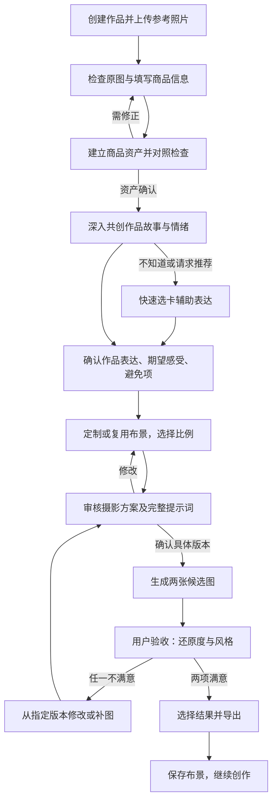

# 手作影像工作台 · 产品需求文档

| 项目 | 内容 |
| --- | --- |
| 版本 | v0.2 |
| 日期 | 2026-10-29，Asia/Shanghai |
| 文档状态 | 评审稿；已按发起人对 v0.1 的评审意见修订，开发阻塞项待逐条确认 |
| 产品名称 | 「一间」为暂用名称 |
| 编写 | v0.1 由 Codex 编写；v0.2 由 Claude Code 按评审意见修订 |
| 评审 | 产品发起人；技术评审人待指定 |
| 首版目标 | 支持约 5 位真实手作商家试用 |
| 决策依据 | [PM 审视与逐轮记录](pm-review.md)、[项目协作说明](../agents.md) |

**阅读约定：**「已确认」指用户明确接受的需求；「验收细化」是本稿为可开发、可测试而提出的规则，待评审；🔶 **假设** 指尚无证据的判断；🔵 **待决策** 指未定事项，⛔ 标记表示**进入开发前必须定**。本文是目标需求，不代表代码已实现。

## 1. 产品摘要

面向已有可售作品、缺少摄影条件、近期希望开始线上获客的独立手作商家，做一个理解作品故事的 AI 商品影像工作台。用户上传真实商品照片，确认商品资产，通过深入共创说明作品表达和风格，审核摄影方案和提示词，再用参考图加提示词生成电商商品主图。工作台长期保存作品、风格、摄影布景和历史版本，方便之后修改和复用。

首版支持饰品静物展示。每次围绕一件作品、从多个可选比例中选一种，生成两张候选图。真实性和风格分别由用户验收，两项都满意才算完成。真人佩戴、多商品批量处理、可调用全部产品能力的 AI 助手留待后续。

🔶 **假设 A1：**缺乏合适商品图是目标用户开始线上销售的重要障碍。🔶 **假设 A2：**深入共创与风格复用的价值足以覆盖操作时间。两者都靠约 5 位真实用户试用验证。

## 2. 问题与证据

### 2.1 需要解决的问题

| 问题假设 | 对用户的影响 | 解决路径 | 需要收集的证据 |
| --- | --- | --- | --- |
| A1：缺少场地、布光和拍摄经验 | 有可售作品，但没有适合发布的图片 | 原图检查、商品资产、定制场景 | 最近一次发布经历、现用图片、具体卡在哪一步 |
| A2：不会把作品故事转成视觉要求 | 说不清想要的效果，反复修改 | 深入共创、推荐选卡、可读摄影方案 | 共创前后需求清晰程度、耗时、返工原因 |
| A3：连续作品难保持个人风格 | 每次从头试，作品视觉不连贯 | 长期风格、布景复用、版本记录 | 第二件作品的实际复用行为与操作时间 |
| A4：生成过程可能改变商品细节 | 图好看但不敢用于销售 | 参考图生成、保真约束、用户验收 | 用户指出的颜色、数量、结构、材质差异及满意度 |

### 2.2 现有依据

- 发起人已明确目标用户、首个使用场景和工作台价值，五轮讨论确认了功能边界。
- 还没有用户访谈、发布记录、付费数据、生成效果评测或成本实测。现有前端只是页面骨架。
- 本文未做外部市场研究。

## 3. 目标用户与使用任务

### 3.1 首批用户（已确认）

- 独立手作商家，有真实可售的饰品作品。
- 缺少摄影工作室、布光设备或相应预算，近期希望开始线上获客。
- 能带一件近期想发布的作品、必要的参考照片和商品信息，参与一次试用并反馈是否采用。由发起人定向邀请约 5 人。

纯兴趣创作者属于更广的潜在人群，本轮不作为首要验证对象。年龄、收入、设备等画像没有证据，不预设。

### 3.2 核心任务

> 当我准备把一件手作饰品放到线上销售时，希望有人理解作品的故事，帮我得到真实、有自己风格的商品主图；下次上新时，还能继续用已经建立的布景和风格。

| 时点 | 用户任务 | 完成信号 |
| --- | --- | --- |
| 第一次创作 | 建档、讲作品、定画面 | 确认商品资产、共创总结和摄影方案 |
| 生成与挑选 | 判断是否还原、是否符合风格 | 至少一张结果两项都满意 |
| 准备发布 | 导出主图 | 下载成功；实际发布另行记录 |
| 再次创作 | 改旧作品或给新作品复用风格 | 找到原版本，或复用布景并确认新方案 |

## 4. 产品定位与阶段目标

### 4.1 定位（已确认）

为缺乏摄影条件、希望开始线上获客的独立手作商家，提供**理解手作故事的商品影像工作台**，帮助他们在尽量还原商品细节的同时，形成并复用自己的视觉风格。

“工作台”包括可积累的作品资产、长期风格、摄影布景、共创记录和结果版本。深入共创是新作品的默认起点。

用户的替代做法包括继续手机拍摄、简单修图、用通用图像工具或延后发布。🔶 **假设 A5：**用户会因为故事理解和风格复用选择本产品。

### 4.2 首版 AI 能力边界（已确认）

| 能力 | 首版 | 说明 |
| --- | --- | --- |
| 参考图＋提示词生成饰品场景图 | 必须有，真实接入 | 首版核心能力；试用必须真实出图 |
| 白底资产处理 | 保留，并与原图直出做 A/B 测试 | 见 4.3 |
| 可调用全部产品能力的 AI 助手（Agent） | 后续 | — |
| 深入共创对话 | 规则引导＋卡片（O12 已定） | 接入大模型后，再由模型根据理解优化追问和卡片内容 |

### 4.3 白底路线 A/B 测试（已确认保留白底步骤）

白底资产步骤保留（Q14）。同时把“先做白底再生成”是否更好当作待验证的技术路线：

- **A 路线：**原图 → 白底资产 → 场景图。
- **B 路线：**原图（可多张）直接作为参考图 → 场景图。
- **比较：**用户满意度、细节还原（细链、镂空、透明材质尤其关注）、失败重试次数、每张满意图的成本和耗时。
- **时机：**先在能力摸底阶段（M1）用同一批真实饰品跑两条路线；试用中是否继续分组对比，看摸底结果再定。
- 测试结果用于决定默认路线，不自动删除白底功能；改变默认路线需发起人确认。

### 4.4 阶段目标

1. **能力摸底：**不做界面，用真实饰品照片跑通生图，验证还原效果、比例、耗时和成本，并完成白底 A/B 对比。
2. **工作台验证：**检查流程、卡片、审核与工作台是否易懂，接入摸底选定的真实生图链路。
3. **约 5 人试用：**观察真实作品从上传到采用的全过程，复访发布和复用情况。

🔵 **待决策 O2：**付费模式、商业目标和扩大投入条件。不阻塞开发。

## 5. 方案总览与工作台流程

### 5.1 信息架构

| 区域 | 承载内容 |
| --- | --- |
| 作品列表 | 创建作品、继续草稿、进入已有作品 |
| 单件作品工作区 | 商品资产、信息卡、共创记录、风格卡、摄影方案、生成与版本 |
| 我的风格 | 店铺长期视觉偏好，变更需用户明确同意 |
| 摄影布景 | 可命名、保存和复用的背景、光线、道具及布局组合 |
| 历史结果 | 每张图的来源素材、方案、比例、生成任务及验收状态 |

布局和页面数量可在设计时调整，但作品、风格、布景和版本之间的关系必须看得见。

### 5.2 主流程

商品资产处理和最终场景生图是两个任务。最终场景图必须在方案和提示词确认后才生成，共创阶段不自动生成场景图。商品资产采用 A 路线还是 B 路线，由 4.3 的测试结果决定默认值。

### 5.3 阶段与状态（验收细化）

- 作品状态：草稿 → 资产待确认 → 共创中 → 总结待确认 → 方案待确认 → 可生成 → 生成中 → 待验收 → 已完成。
- 用户可回到前序环节编辑；前置条件未满足时可以查看后续区块，但不能发起最终生图。
- 保存草稿和批准方案是两种操作，保存不等于允许生成。
- 每个结果分别记录还原度和风格：未评价／满意／不满意。任一项不是“满意”就不标完成。
- 修改素材、商品信息、共创总结、布景、比例或提示词后，待生成方案需重新确认；已完成的历史结果保留当时快照。

## 6. 成功指标与约 5 人试用计划

### 6.1 指标定义

口径为本稿建议，目标值待定。样本小，报告时用「人数／实际样本数」加原因，不做统计推断。

| 类别 | 指标与口径 | 记录方式 | 目标 |
| --- | --- | --- | --- |
| 主指标（O3 已定） | 采用意愿人数：试用结束时明确表示会把本工具生成、两项都满意的主图用于发布 | 试用结束当场询问并记录原话 | ≥3 人继续；1–2 人调整；0 人停止 |
| 参考 | 事后实际发布人数（用户主动告知即记录，不设观察期） | 用户自愿反馈 | 不计入门槛 |
| 激活 | 获得至少一张两项都满意的结果的人数／启动试用人数 | 验收记录 | 试用建立基线 |
| 满意度 | 对候选图还原度和风格的满意情况及原因 | 验收选择＋访谈 | 试用建立基线 |
| 完成效率 | 首次上传到第一张满意图的总耗时；另记共创操作、等待和离开时长 | 事件时间与观察记录 | 试用建立基线 |
| 体验 | 完成共创、转选卡、中途退出、请求帮助的人数及原因 | 操作事件与访谈 | 试用建立基线 |
| 复用 | 第二件作品实际复用风格或布景的人数 | 用户再次使用时记录（同一设备，见 O5） | 试用建立基线 |
| 成本 | 单次任务成本、失败重试成本、每张满意图累计成本 | 服务用量，含废弃候选图 | 合计 500 元内（O4） |

### 6.2 试用安排

1. 发起人定向邀请约 5 位商家，每人准备一件近期想发布的真实作品及照片。
2. 开始前了解最近一次准备商品图的过程、现用办法和预计发布渠道。不预先承诺能提高销量。
3. 用户完成：上传并确认资产 → 共创 → 审核方案 → 生成 → 验收 → 修改或导出。
4. 观察者记录卡点、人工帮助、等待、转选卡和未采用的原因；有人辅助的单独标记。
5. 试用结束当场询问：会不会用这张图发布、为什么、缺什么功能。不设观察期；用户事后主动告知发布或再次使用时补记。
6. 输出每位用户的结果和共性问题。生成质量不足先修生成；共创价值不足调整引导，不绕过已确认的共创流程。

**单人记录模板：**匿名编号｜饰品类型｜发布渠道｜现用办法｜照片问题｜共创摘要｜是否转选卡及原因｜方案／比例｜白底路线 A/B｜候选图数｜还原度与风格评价及原因｜修改与补图次数｜耗时／人工帮助｜累计成本｜导出｜实际发布｜布景复用｜建议。

## 7. 功能需求与验收条件

### 7.1 范围

以下均属首版。编号验收条件是对共识的细化建议，与已确认需求冲突时以已确认为准。

| 编号 | 能力 | 共识来源 |
| --- | --- | --- |
| FR-01 | 作品列表、单件工作区与进度保存 | Q10、Q13 |
| FR-02 | 多参考图、商品资产（含白底）与对照检查 | Q11、Q14、Q18、v0.2 评审 |
| FR-03 | 商品信息与可选需求卡 | Q19、最初需求 |
| FR-04 | 深入共创、推荐选卡与总结确认 | Q3、Q6 |
| FR-05 | 风格卡及聊天双向编辑 | Q12、最初需求 |
| FR-06 | 长期风格与可复用摄影布景 | Q10、Q20 |
| FR-07 | 摄影方案、提示词与版本批准 | Q16、最初需求 |
| FR-08 | 多比例可选、两张候选与任务反馈 | Q15、Q21、v0.2 评审 |
| FR-09 | 用户验收、指定版本修改及对比 | Q5、Q17、v0.2 评审 |
| FR-10 | 结果导出与试用记录 | 主图交付所需 |

### FR-01 作品工作区与保存

**用户故事：**作为商家，我希望每件作品有可继续使用的工作区，下次修改时能找回素材、故事与方案。

- AC-01.1：创建作品后获得独立档案，列表显示名称、封面和当前进度；打开后恢复对应内容。
- AC-01.2：工作区提供资产、共创、方案、结果等入口；回访用户不被当成新用户。
- AC-01.3：新作品必须先完成本件共创，沿用布景不能跳过共创；已有且未变更的总结不重复访谈。
- AC-01.4：保存成功才显示“已保存”；失败时说明原因、保留编辑内容并可重试。
- **O5（已定）：**试用期数据存在浏览器本地，不做账号和跨设备同步。复访须用同一设备和浏览器，试用前告知用户；清除浏览器数据会丢失记录。

### FR-02 商品照片与商品资产

**用户故事：**作为商家，我希望用多张真实照片描述商品，并检查处理后的资产有没有丢细节。

- AC-02.1：一件作品可添加多张参考图，区分整体、背面或细节；改动所选素材后，待生成方案需重新确认。
- AC-02.2：原图始终保留；白底图作为派生素材单独记录来源，不覆盖原图。
- AC-02.3：支持原图／白底对照与放大检查，提示看镂空、细链、透明部分、轮廓和数量；用户确认后资产才可用。
- AC-02.4：原图模糊、商品不完整或缺必要角度时说明问题并引导补拍，不编造看不到的结构。
- AC-02.5：首版支持饰品静物展示（平铺、悬挂、支架等）；用户要求真人佩戴时说明本期不支持，保留需求。
- AC-02.6：系统记录每次生成使用的是 A 路线（白底）还是 B 路线（原图直出），供 4.3 的对比统计。
- 🔵 **O6：**文件类型、大小、张数上限，结合实际服务确定，前后端校验一致。

### FR-03 商品信息与需求卡

**用户故事：**作为商家，我希望助手了解商品信息，又不要求我先填完所有营销信息。

| 字段 | 用途 | 输入规则 |
| --- | --- | --- |
| 作品名称 | 档案识别、版本归属 | 可先用自动草稿名，允许修改 |
| 品类 | 耳饰、项链、手链等，影响摆放建议 | 核心信息；系统识别只作建议 |
| 主要材料与表面质感 | 区分金属、透明、织物等展示需求 | 核心信息；不把模型猜测写成事实 |
| 实际尺寸及单位 | 帮助选择道具与主体占比 | 核心信息，可标“未知” |
| 不可改变的细节 | 数量、结构、连接、纹样、颜色等 | 核心保真约束，用户可补充 |
| 售价或区间 | 理解定位 | 选填 |
| 目标顾客／购买用途 | 判断展示语境 | 选填，需要时再问 |

- AC-03.1：核心信息可记为“未知”，不自动填入虚构的材料或尺寸；影响构图时再针对性追问。
- AC-03.2：改动尺寸、材料或不可改变的细节后，展示受影响的方案内容并要求重新确认。
- AC-03.3：没填售价或目标顾客，不影响进入共创和方案审核。

### FR-04 深入共创与快速选卡

**用户故事：**作为手作人，我希望助手先理解作品的灵感，再帮我把感觉变成画面。

- AC-04.1：新作品默认按预设顺序提出灵感、主题、情绪等开放问题，跳过已填写的内容，不重复问已回答的问题。
- AC-04.2：每个共创问题旁提供明确的「我不知道，给我推荐」入口，点击后进入快速选卡。（首版为规则引导，不做自由文本意图识别。）
- AC-04.3：选卡给出可修改的方向和理由，可选“都不合适／换一组”。
- AC-04.4：共创结束形成三项总结：作品想表达什么、希望顾客感受到什么、明确避免什么。用户确认后共创阶段才完成。
- AC-04.5：允许记录“暂无明确故事”；助手可推荐视觉方向，但不编造作者经历、灵感或材料寓意。
- AC-04.6：用户修改故事后，总结和风格建议同步更新；已批准未生成的旧方案失效。

### FR-05 风格需求与双向编辑

**用户故事：**作为用户，我希望聊天和卡片描述的是同一份方案，不用重复输入。

| 风格维度 | 卡片内容 |
| --- | --- |
| 色调 | 背景主色、冷暖、与饰品的对比；可选色或用自然语言描述 |
| 背景 | 纸、布、木、石、纯色等材质与纹理强度 |
| 光线 | 方向、明暗、柔硬、冷暖、阴影；不要求懂摄影术语 |
| 摆放 | 平铺、悬挂、支架及商品角度；必要角度需有素材支持 |
| 道具 | 类型、数量、位置；必须出现与禁止出现的元素 |
| 构图 | 主体占比、位置、留白和所选比例 |
| 表达 | 与共创总结对应的氛围重点和避开的效果 |

- AC-05.1：助手把用户明确说过的内容整理进对应字段并标明改动；推测和推荐显示为待确认建议。
- AC-05.2：用户手动编辑卡片后，对话和方案使用最新内容，不被旧摘要覆盖。
- AC-05.3：发现冲突（如要求无道具又指定托盘）时指出并请用户决定。
- AC-05.4：草稿改动不需要逐次审批，但最终生图必须经过完整方案确认。

### FR-06 店铺风格与摄影布景

**用户故事：**作为商家，我希望作品档案与布景长期积累，下一件作品能延续自己的风格。

- AC-06.1：店铺长期风格、摄影布景、单件方案分开保存，使用时显示来源。
- AC-06.2：满意的背景、光线、道具和布局可保存为可命名布景；布景是方案参数，不是某张结果图。
- AC-06.3：复用布景时按新商品和所选比例重新适配，不带入旧商品的结构、故事、尺寸或细节约束。
- AC-06.4：单件调整不自动改长期风格或已存布景；用户明确选择更新才写入。
- AC-06.5：布景更新不改写历史方案，历史结果仍对应原快照。

### FR-07 方案与提示词批准

**用户故事：**作为用户，我希望清楚知道将生成什么，并能在生成前修改。

- AC-07.1：默认显示可读方案：保真要求、背景、光线、摆放、道具、构图、比例、候选图数量。
- AC-07.2：完整提示词可展开修改，改动同步回可读方案；无法对应时显示差异，两份矛盾的内容不能一起被批准。
- AC-07.3：批准绑定素材版本、商品信息、共创总结、布景、比例、提示词和输出数量的快照。
- AC-07.4：批准后再改相关内容，旧批准失效，需重新展示改动并确认。
- AC-07.5：未经明确确认不发起最终生成；保存、继续聊天、切换页面都不算确认。

### FR-08 生成任务与比例

**用户故事：**作为用户，我希望选择适合的比例，用同一方案生成两张候选主图，并知道任务进度。

- AC-08.1：提供多个可选比例，由用户每次选一种；批准方案时显示所选比例。首版选项包括 `1:1`、`3:4`、`9:16`，用户想选哪个就选哪个（已确认，2026-10-29）；后续可按需增加，受模型能力（⛔ O7）约束。下表仅供参考，不用于限制用户选择：

| 平台 | `1:1` 主图 | `3:4` 主图 | 依据（核实日期 2026-10-29） |
| --- | --- | --- | --- |
| 淘宝／天猫 | 必传；平台建议优先 1:1 | 可选的另一组主图，只接受 3:4 | [淘宝开放平台《商品接口调整通知》2024-01-26](https://open.fliggy.com/support/announcementDetail.htm?id=25721)（一手） |
| 微信小店 | 必传 3–9 张；不限形状，但商详页按正方形展示 | 可选，最多 1 张，须为 3:4 | [微信小店「添加商品」接口文档](https://developers.weixin.qq.com/doc/store/shop/API/channels-shop-product/shop/api_addproduct.html)（一手） |
| 小红书店铺 | 支持（常见 800×800） | 支持（常见 750×1000） | 仅第三方资料，如 [标记侠速查](https://www.biaojixia.com/specs/xiaohongshu)；官方规范需登录商家后台核实 |

像素：淘宝开放平台公告未写像素；第三方资料常见 1:1 不低于 800×800（放大镜功能门槛）、3:4 为 750×1000，未经官方核实，由 O7 结合模型输出确定。朋友圈不是店铺主图渠道，无固定规格。
- AC-08.2：同一已批准方案生成两张候选图，记为同一任务；不悄悄换商品或视觉方向来凑数量。
- AC-08.3：要其他比例时从所选版本重新构图、审核并生成，不用机械裁切代替。
- AC-08.4：显示真实的排队、处理中、成功、部分成功或失败状态；没有进度信息时不显示假百分比。
- AC-08.5：防止重复点击产生重复任务；一张失败时保留成功的那张，提示可补齐，不自动无限重试。
- AC-08.6：服务未配置或仅为演示时明确标示，不把占位图或本地构图称为 AI 生成。

### FR-09 用户验收、修改与版本对比

**用户故事：**作为商家，我希望图里的商品尽量和实物一致、风格是我想要的，并能从满意的版本继续改。

验收原则（已确认）：**用户满意是验收标准**。系统尽量还原商品细节，但不要求和原图完全一样；只要用户认可还原度和风格，即视为通过。

- AC-09.1：每张候选图分别评价还原度和风格；评价还原度时可对照原图，评价风格时可对照批准方案和共创总结。
- AC-09.2：用户可指出具体不满意之处：颜色、数量、轮廓、连接结构、纹样、材质，或背景、光线、道具、构图。
- AC-09.3：两项都满意才标为完成；否则进入修改、补图或补拍，保留原风格诉求。
- AC-09.4：选定父版本后修改，展示变化，重新批准再生成；原结果保留。
- AC-09.5：支持至少两版对比，可查看各自比例、方案及验收状态。
- AC-09.6：用户验收只代表用户满意，不代表系统保证与实物完全一致或符合平台规则。

### FR-10 导出与试用记录

**用户故事：**作为商家，我希望下载选中的主图，并能找回对应的创作记录。

- AC-10.1：可下载两项都满意的选定结果，保持对应比例；失败可重试，不显示虚假成功。
- AC-10.2：未通过的结果不标为已完成；是否允许作为草稿下载见 O8。
- AC-10.3：结果与素材、方案的关联可追溯。
- AC-10.4：导出与实际发布分开记录。试用数据用匿名标识，一般事件中不存整段聊天或商品原图。
- 🔵 **O8：**导出格式、像素、压缩质量、是否允许草稿下载；默认不加水印。

### 7.2 数据对象与版本关系（验收细化）

| 对象 | 必要关联与状态 |
| --- | --- |
| 作品 | 名称、商品信息、资产列表、当前进度、会话、方案与版本 |
| 商品资产 | 原图／细节图／白底图、来源、处理任务、确认状态 |
| 共创总结 | 表达、期望感受、避免项、确认版本 |
| 长期风格 | 店铺偏好及用户同意的变更记录 |
| 摄影布景 | 名称、背景、光线、道具、布局、版本 |
| 摄影方案 | 素材与信息快照、总结版本、布景参数、比例、提示词、输出数量、资产路线（A/B）、批准状态 |
| 生成任务 | 已批准方案版本、执行状态、服务记录、失败与重试、候选图、成本 |
| 结果版本 | 对应任务、父结果、图片、两项验收、修改原因、导出记录 |

具体数据库结构由技术设计决定。关键约束：历史可追溯、草稿可编辑、长期偏好不被单件修改污染。

### 7.3 异常与非功能要求（验收细化）

| 场景 | 必须满足的行为 |
| --- | --- |
| 页面刷新或中断 | 恢复已保存内容；生成中的任务按实际服务状态处理，不自动重新提交 |
| 图片或服务失败 | 保留已上传和已成功的结果，指出失败对象，给出恢复路径 |
| 所选素材被删除或替换 | 不能用失效引用发起新任务；历史保留策略见 O5 |
| 审核后比例或提示词变化 | 旧批准失效，重新确认 |
| 故事或风格修改 | 更新受影响内容，不改写历史结果或店铺风格 |
| 存储满或服务不可达 | 显示未保存，不误报已保存 |
| 触屏与键盘 | 上传、表单、对话、批准、对比、导出都能完成；主要操作有可访问名称和反馈 |
| 数据与密钥 | 密钥不进前端和版本库；上传、聊天和卡片内容按不可信输入处理 |

🔵 **O9：**支持的设备／浏览器、性能目标、任务超时、数据保留时长；用户数据传给外部服务的方式须在试用前告知用户。

## 8. 本期范围之外

| 后续事项 | 理由 |
| --- | --- |
| 可调用全部产品能力的 AI 助手（Agent） | v0.2 评审确认后放；首版先保证生图能力 |
| 真人佩戴与人体场景 | 本期先验证静物主图 |
| 多商品批量处理 | 本期围绕单件作品，多参考图仍支持 |
| 一次任务同时生成多个比例 | 已确认一次选一种比例，其他比例重新构图和批准 |
| 带字营销主图、完整详情页 | 首条交付为无字单品主图 |

店铺自动发布、交易管理、付款订阅、品牌设计工具等不在本期。🔵 **O10：**未讨论的能力若要纳入，单独评估，不挤占已确认功能。

## 9. 风险与交付顺序

### 9.1 主要风险

| 风险 | 类别 | 触发信号 | 处理 |
| --- | --- | --- | --- |
| 细链、镂空、透明材质生成后变形，用户不满意 | 可行性，A4 | 摸底或试用中还原度频繁不满意 | M1 先用真实饰品摸底；比较 A/B 路线；不达标先改生成链路再做工作台 |
| 重试多导致每张满意图成本过高 | 可持续性 | 大量重试、满意结果少 | M1 实测成本；按 O4 设定预算和暂停条件 |
| 用户并非因图片而迟迟不上线 | 价值，A1 | 访谈显示主要障碍在别处 | 核对原始任务，调整价值判断 |
| 深入共创负担大于收益 | 易用性，A2 | 退出、重复解释、频繁转选卡 | 记录原因，优化追问与卡片，保持共创为默认入口 |
| 自由摆放依赖没拍到的角度 | 可行性 | 参考图看不到隐藏结构 | 要求补拍，不把推断写成事实 |
| 图好看但不被采用 | 价值，A5 | 当场意愿低；或口头愿意但实际不发 | 当场追问原因；采用意愿是口头信号，可能高估实际发布 |
| 工作台只存在浏览器本地（O5 已定） | 可行性／信任 | 换设备或清缓存丢记录，影响复访 | 试用前告知用户；复访安排在同一设备；正式版再评估云端 |
| 输出比例与目标平台不符 | 外部依赖 | 平台拒收或需重处理 | 已核对淘宝、微信小店官方规范（AC-08.1）；小红书需登录后台再核实 |

### 9.2 交付顺序（v0.2 调整）

把最大风险（A4 生成还原度）放到最前面验证：生图效果不达标，后面的工作台做得再完整也用不上。

| 阶段 | 交付 | 进入下一阶段的条件 |
| --- | --- | --- |
| M0 文档评审 | 本 PRD；确定 ⛔ 阻塞项 | 阻塞项有答案或明确负责人 |
| M1 生图能力摸底 | 不做界面：用 5–10 件真实饰品照片（耳饰、项链、手链都有，刻意包含细链、镂空、透明材质）跑 A 路线（原图 → 白底 → 场景图）和 B 路线（原图直出），记录还原度、发起人满意度、耗时、单张满意图成本；确定模型、可用比例和默认路线 | 发起人认为效果可用于试用；O4、O7 有实测依据 |
| M2 工作台＋真实生图 | 作品工作区、资产、共创、选卡、双向编辑、方案审核、比例、生成、验收、版本、布景、导出、存储 | 主链用真实生图跑通；演示内容明确标示 |
| M3 约 5 人试用 | 任务记录、发布反馈、复用反馈、质量与成本记录 | 按事先定好的门槛决定继续、调整或停止 |

🔵 **O11：**负责人、开发资源和排期待定。现有 HTML／CSS 骨架不代表 M2 已完成，`app.js` 尚缺。

## 10. 待决策事项

### 10.1 ⛔ 进入开发前必须定

| 编号 | 问题 | 状态 |
| --- | --- | --- |
| O1 | 首批目标平台 | **已定**：淘宝／天猫、小红书店铺、微信小店／朋友圈。主图规范已查（见 AC-08.1）：三个平台共同基础为 1:1，3:4 为可选，均不用 9:16；小红书官方规范未核实；饰品类型不限，M1 素材刻意覆盖细链、镂空、透明材质 |
| O3 | 试用成功门槛 | **已定**：不设观察期，以试用结束时的采用意愿为准；≥3 人继续，1–2 人调整，0 人停止 |
| O4 | 生图预算 | **已定**：M1 摸底＋5 人试用合计 500 元以内；单张成本上限和重试暂停条件由 M1 实测后提出 |
| O5 | 数据存储 | **已定**：浏览器本地，见 FR-01 |
| O7 | 生图模型与服务、像素、比例适配、失败补齐 | M1 产出结论，须在 500 元预算内 |
| O12 | 首版共创对话实现方式 | **已定**：规则引导＋卡片；大模型后续用于优化追问和卡片 |

### 10.2 可以后放

| 编号 | 问题 | 最晚节点 |
| --- | --- | --- |
| O2 | 付费模式、商业目标、扩大投入条件 | 商业试验前 |
| O6 | 图片类型、大小、张数上限 | M2 上传功能验收前 |
| O8 | 导出格式、质量、草稿下载 | M2 导出验收前 |
| O9 | 设备、性能、超时、数据保留与传输告知 | M3 试用前 |
| O10 | 未讨论的扩展功能 | 需要扩大范围时 |
| O11 | 负责人、资源、排期 | 开发计划承诺前 |

## 附录 A：决策追溯

| 共识 | 来源 |
| --- | --- |
| 约 5 人真实试用，由发起人定向邀请 | Q4、Q7 |
| 首批为已有可售作品、近期想线上获客的独立商家 | 第一轮 Q1，第二轮补齐 |
| 真实性与自由度同时追求，两项都满意才算完成 | Q2、Q5；v0.2 评审改为以用户满意为准 |
| 深入共创优先，不知道时转选卡，确认三项总结 | Q3、Q6 |
| 故事理解与个人视觉风格为核心定位 | Q8 |
| 首个主场景为电商商品主图 | Q9 |
| 长期工作台、店铺风格及单件档案 | Q10、Q13 |
| 单件作品、多参考图，聊天与卡片双向同步 | Q11、Q12 |
| 白底资产需检查，保留原图与细节 | Q14；v0.2 评审增加与原图直出的 A/B 测试 |
| 无字单件主图，比例可选 | Q15；v0.2 评审改为多个可选比例，不限于三种 |
| 可读方案与完整提示词审核，确认后生成 | Q16 |
| 指定版本修改、历史保留与对比 | Q17 |
| 静物优先，真人佩戴后续 | Q18 |
| 核心商品信息可标未知，售价及顾客选填 | Q19 |
| 保存并复用可命名摄影布景 | Q20 |
| 每次一种比例，两张候选，其他比例重新构图 | Q21 |
| 首版必须有真实参考图生图；Agent 型助手后放 | v0.2 评审 |
| 目标平台淘宝／天猫、小红书、微信小店；预算 500 元内；浏览器本地存储；共创为规则引导＋卡片 | v0.2 阻塞项问答（O1、O4、O5、O12） |
| 试用门槛以当场采用意愿计，≥3 继续／1–2 调整／0 停止；饰品类型不限 | v0.2 阻塞项问答（O3） |
| 先做生图能力摸底，再做工作台 | v0.2 评审建议，发起人确认首版须有真实生图 |

## 附录 B：文档自评

- **最完整：**工作台流程、确认规则、功能边界和版本关联。
- **最弱：**用户问题证据、生成能力、单张满意图成本、发布采用基线；需要 M1 摸底和 M3 试用补齐。
- **高风险假设：**A1 图片是重要障碍；A2 深入共创值得花时间；A4 能在可接受成本内让用户满意还原度；A5 用户会实际采用并复用。

## 变更记录

| 版本 | 日期 | 内容 |
| --- | --- | --- |
| v0.1 | 2026-10-29 | 基于五轮 grilling 共识创建 |
| v0.2 | 2026-10-29 | 按发起人评审修订：交付顺序改为先做生图能力摸底；首版必须真实生图，Agent 型助手后放；比例改为多个可选；白底保留并与原图直出 A/B 测试；验收以用户满意为准；待决策项区分开发前必须定与可后放；新增 O12；全文精简；记录 O1、O3、O4、O5、O12 答复；核对三平台主图比例 |
