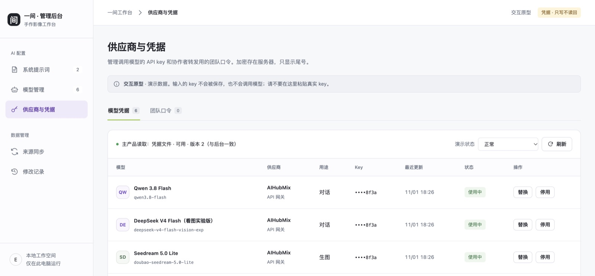
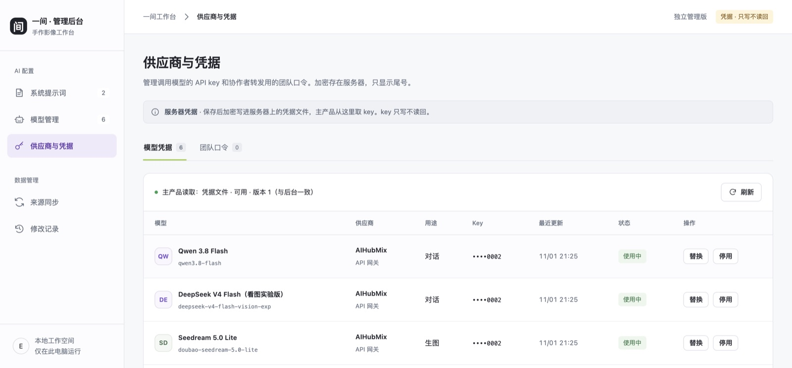
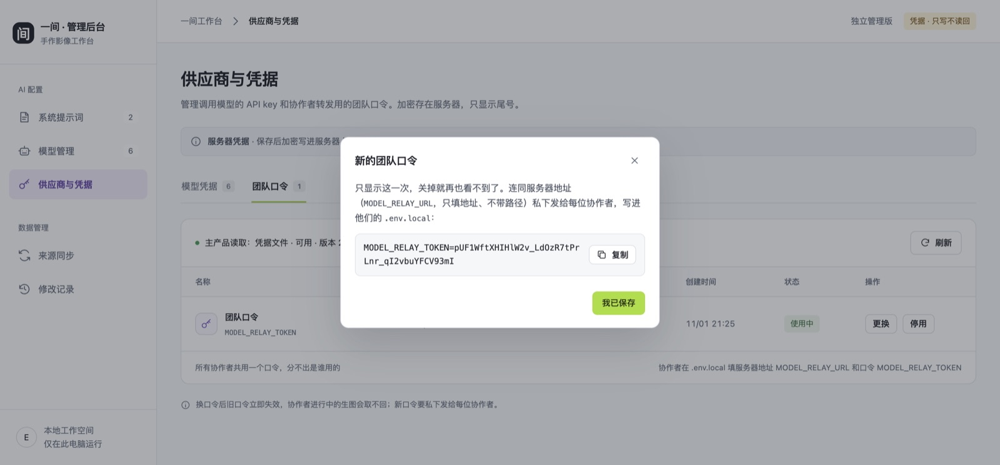

# 验收记录

日期：2026-11-01，Asia/Singapore。

## 阶段交付

1. PRD 与技术方案先成文，落实用户确认的“先交互原型，再独立管理；允许单向同步，不能写回”。
2. 原型生成真实源码静态快照，2 个固定提示词、6 个模型；先启动原型并在浏览器确认页面与列表。
3. 正式版接入真实只读来源和独立 JSON 存储；原型保留。未安装依赖、调用模型、推送或部署。

## 自动验证

`正式代码/` 下执行 `npm run check` 和 `npm test`，11 项测试全部通过：

| 验证               | 实际断言                                                                               |
| ------------------ | -------------------------------------------------------------------------------------- |
| 真实来源读取       | 2 个固定提示词、6 个模型、默认 ID、3 个 SHA-256 摘要与 keep 变量；输出不含环境密钥字段 |
| 提示词持久化和恢复 | 保存前内容入历史；恢复生成新版本；重建 store 后内容一致                                |
| 并发版本           | 同 revision 并发保存只成功一个，另一个返回 409，新数据不被覆盖                         |
| 模型管理           | 新增、默认、启停；重复 ID、改变已有 API ID、停用默认模型均拒绝                         |
| 数据校验           | 负价、缺少像素尺寸、非法参数对象、空提示词均拒绝且不写记录                             |
| 单向同步           | 未编辑项更新；冲突提示词保留；后台启停保留；模型未编辑字段跟随来源                     |
| 来源增删           | 新增模型进入后台，移除模型仍保留并记录来源已移除                                       |
| 同步过期           | 来源摘要与预览不同时拒绝同步，后台文件不变                                             |
| 损坏数据           | JSON 解析错误明确报错，保留原文件                                                      |
| 来源读取失败       | 同步失败并保留后台原数据                                                               |
| HTTP               | 保存、导出有效；跨来源写入、任意文件读取、不支持的操作被拒绝                           |

原型 `npm run check` 已通过。测试没有启动主产品或访问 AIHubMix。

## 浏览器验证

使用原生 CUA。隔离的 `4178` 服务单独保存验证数据，交付的 `4177` 没有验证草稿或测试模型。

- 提示词：编辑 → 保存前差异对比 → 回草稿 → 保存 → 刷新后仍在；已验证。
- 模型：新增一条测试模型 → 列表出现 → 设为后台默认 → 停用按钮禁用；已验证。
- 同步：真实读取来源 → 预览无变化 → 确认 → 后台提示词修改仍保留；已验证。
- 错误修正：空提示词保存失败会持续显示错误与重新载入入口；非法 JSON 切换尺寸策略会显示错误并恢复原选择；已在浏览器复验。
- Chrome 实际桌面视口为 1440×667，页面宽度为 1440，无页面整体横向溢出；截图见下方。804px 内嵌窗口已查看，提示词布局改为上下排列，表格允许内部横向滚动。

## 审查修正

按界面技能进行独立代码审查，发现 3 项并修正：保存失败提示不持续、未保存编辑恢复提示不准确、非法 JSON 切换表单未捕获。复核结论仅覆盖这 3 项，均 resolved。没有将复核等同于整站无缺陷证明。

## 验证限制与调用失败

- impeccable 上下文加载器执行权限被拒绝，改为读取现有项目文档与参考源码。
- 内嵌浏览器桌面尺寸覆盖未生效，实际仍为 804×664；切换原生 Chrome 完成桌面检查。
- 内嵌浏览器测试历史恢复确认弹窗时，点击与后续弹窗读取超时；尝试查看 Codex 应用被原生工具禁止，停止该路径。历史恢复的数据行为有自动测试；确认弹窗交互未在浏览器完成闭环，不声称已通过。
- 收尾关闭内嵌验证标签页也因同一焦点命令超时而未确认成功；已停止隔离验证服务并删除本轮测试数据，Chrome 正式后台不受影响。
- 未做读屏、完整键盘走查、Safari/Firefox 或真实模型调用。没有验证远端与多进程部署。
- Node 读取来源 TypeScript 的模块类型警告仍保留，未为消警告修改主代码。

## 截图

## v1.1 供应商与凭据（2026-11-01）

- 原型：在原有原型上加「供应商与凭据」页（起初叫「服务商与凭据」，用户定统一叫「供应商」后改名），参考 CBI「接入与采购」的排版；用户看过后要求表格改成一行一个模型（第一列模型、第二列供应商），已改。原型可切「演示状态」（正常、服务器未设置、凭据文件读不出、解密失败、主产品没运行、主产品仍用环境变量）；输入的 key 只取尾号，不进浏览器存储，弹窗关闭即清空。
- 自动验证：`npm run check` 通过；`npm test` 19 项全部通过（新增 8 项：没配置时拒绝写入、配置与替换、版本冲突与录入检查、停用与启用、团队口令只返回一次、坏文件不覆盖、换主密钥后重新录入、HTTP 层的同源与 8 KB 限制和取不回 key）。
- 主产品一侧（`正式代码/`）：单元测试 149 个、类型检查、lint、生产构建、Playwright 全流程 4 条通过；其中新增 30 个（加解密与文件校验、三种凭据来源、停用与不回退、上一把 key 的 24 小时、脱敏、转发入口与路径白名单、转发对话与生图、旧任务换 key 重查），对两条规则做过变异检查。
- 联调（Chrome 隔离标签页加本机进程，临时凭据文件、假 key、临时账本，不花钱）：后台页面录入假 key 后，主产品 `file` 模式读到同一份文件，状态显示「可用 · 版本 1（与后台一致）」；生成团队口令后，服务器转发入口对的口令放行、错的返回 401、白名单外的路径返回 404；协作者实例（`relay` 模式）状态可用；协作者发一次生图请求，经服务器换上假 key 发到 AIHubMix，被以「invalid or missing API key」拒绝，说明没有用 `.env.local` 里的真 key，两边账本都退回了预留；后台停用 key 后，协作者状态立即变为不可用，新请求返回 503。凭据文件权限 600，文件、页面和接口响应里都没有 key 或口令原文。
- 联调中发现并修复：服务器因 key 停用拒绝（503 `not_configured`）时，协作者本地账本留下一条预留；`/api/images` 改为遇到 `not_configured` 也退回，复测通过。
- 改名和「`MODEL_RELAY_URL` 只填服务器地址」之后复验（同日）：后台 19 项、主产品 149 个单元测试通过；重新构建后三进程联调，后台页面录入假 key，主产品显示「可用 · 版本 1（与后台一致）」；协作者实例只填 `http://127.0.0.1:3210`，状态为转发模式、可用。带路径的写法会报「只填服务器地址」（单元测试覆盖）。截图已换成新名称。
- 未验证：真实 key 的调用（花钱，另行授权）；香港服务器部署与 SSH 隧道（`npm run remote` 只验证了命令拼接和地址检查）；读屏、Safari、Firefox。

